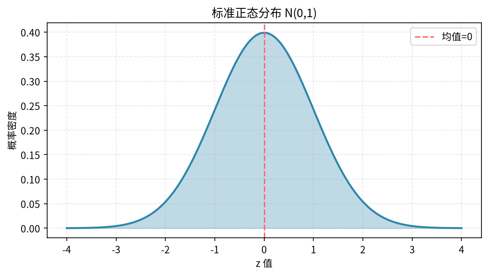
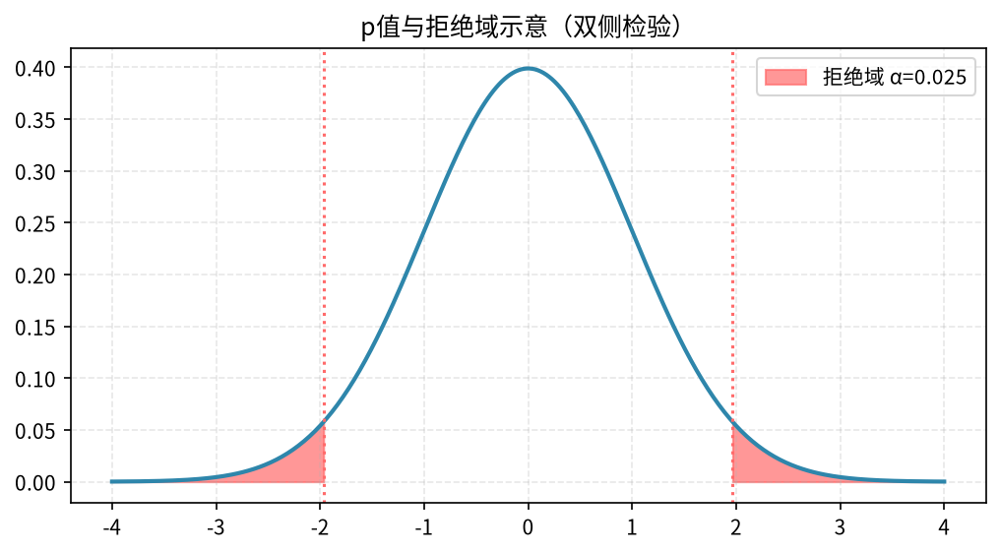
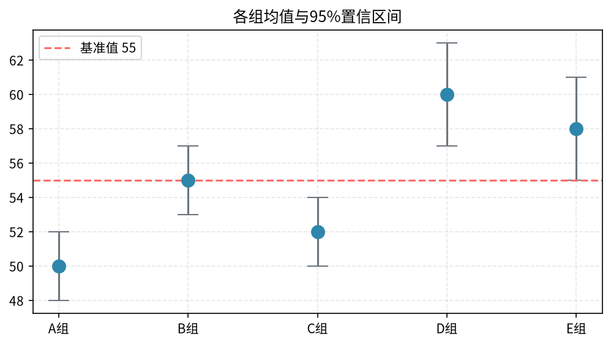

# 第05章 统计分析与假设检验

> EDA告诉你"看起来有差异"，假设检验告诉你"这个差异是真的，还是随机波动？" 这是数据分析从"描述"走向"推断"的关键一步。

---

## 5.1 统计基础回顾

### 5.1.1 描述统计 vs 推断统计

| 类型 | 回答的问题 | 工具 |
|------|-----------|------|
| 描述统计 | 数据长什么样？ | 均值、中位数、方差、分布 |
| 推断统计 | 从样本能推断总体吗？ | 置信区间、假设检验、p值 |

**核心思想：** 我们通常只能看到样本，想知道总体的规律。抽样有随机性，所以需要用统计方法判断"观察到的差异是不是显著的"。



### 5.1.2 关键概念

- **总体（Population）**：所有研究对象
- **样本（Sample）**：实际观察到的数据
- **参数（Parameter）**：总体的特征（如总体均值μ）
- **统计量（Statistic）**：样本的特征（如样本均值x̄）
- **显著性水平α**：通常取0.05，即"5%的概率误判"

---

## 5.2 假设检验的核心逻辑

### 5.2.1 假设检验五步走

```
Step 1: 提出假设
  - H0（原假设）：没有差异 / 没有效果
  - H1（备择假设）：有差异 / 有效果

Step 2: 选择检验方法
  - 比较两个均值？→ t检验
  - 比较多个均值？→ 方差分析ANOVA
  - 比较比例？→ 卡方检验
  - 非正态分布？→ 非参数检验

Step 3: 计算p值
  - p值：在H0成立的前提下，观察到当前（或更极端）结果的概率

Step 4: 决策
  - p < α（通常0.05）→ 拒绝H0 → 差异显著
  - p ≥ α → 不能拒绝H0 → 差异不显著

Step 5: 业务结论
  - 统计显著 ≠ 业务显著
  - 还要看效应量大小
```

### 5.2.2 p值怎么理解

**p值 = 0.03 意味着什么？**

如果原假设成立（两组真的没差异），那么观察到当前这么大（或更大）差异的概率只有3%。

因为3%太小了（小于5%的阈值），我们倾向于认为"原假设不成立"，即两组确实有差异。

**常见误解：**
- ❌ "p=0.03意味着H1为真的概率是97%"
- ✅ "p=0.03意味着如果H0为真，出现当前结果的概率是3%"



---

## 5.3 常用假设检验方法

### 5.3.1 t检验：比较两组均值

**什么时候用：** 比较两个组的均值是否有显著差异。

**三种类型：**

| 类型 | 场景 | 例子 |
|------|------|------|
| 单样本t检验 | 样本均值 vs 已知值 | 新版转化率是否>5% |
| 独立样本t检验 | 两个独立组的均值 | A版和B版的转化率差异 |
| 配对t检验 | 同一对象前后对比 | 用户使用前后的满意度变化 |

**Python实现：**

```python
from scipy import stats

# 独立样本t检验
group_a = [100, 102, 98, 99, 101, 103, 97, 100, 99, 101]  # A版转化率
group_b = [105, 108, 103, 107, 106, 109, 104, 108, 105, 107]  # B版转化率

# 先检验方差齐性
levene_stat, levene_p = stats.levene(group_a, group_b)
print(f"方差齐性检验: p={levene_p:.4f}")

if levene_p > 0.05:
    # 方差齐，用标准t检验
    t_stat, p_value = stats.ttest_ind(group_a, group_b, equal_var=True)
else:
    # 方差不齐，用Welch's t检验
    t_stat, p_value = stats.ttest_ind(group_a, group_b, equal_var=False)

print(f"t统计量: {t_stat:.4f}")
print(f"p值: {p_value:.4f}")
print(f"结论: {'显著' if p_value < 0.05 else '不显著'}")

# 效应量：Cohen's d
from math import sqrt
n1, n2 = len(group_a), len(group_b)
pooled_std = sqrt(((n1-1)*np.var(group_a, ddof=1) + (n2-1)*np.var(group_b, ddof=1)) / (n1+n2-2))
cohens_d = (np.mean(group_b) - np.mean(group_a)) / pooled_std
print(f"Cohen's d: {cohens_d:.3f}")
```

**Cohen's d解读：**
- 0.2：小效应
- 0.5：中等效应
- 0.8：大效应

### 5.3.2 卡方检验：比较比例/分类变量

**什么时候用：** 比较两个或多个分类变量的分布是否有差异。

**例子：** 不同城市等级的用户，转化率是否有差异？

```python
import pandas as pd
from scipy import stats

# 构造列联表
# 行：城市等级  列：是否转化
ct = pd.DataFrame({
    '转化': [500, 300, 200],
    '未转化': [4500, 2700, 1800]
}, index=['一线', '二线', '三线'])

print("列联表:")
print(ct)

# 卡方检验
chi2, p_value, dof, expected = stats.chi2_contingency(ct)

print(f"\n卡方统计量: {chi2:.4f}")
print(f"p值: {p_value:.4f}")
print(f"自由度: {dof}")
print(f"结论: {'显著' if p_value < 0.05 else '不显著'}")

# 计算各行的转化率
ct['转化率'] = ct['转化'] / (ct['转化'] + ct['未转化'])
print("\n各组转化率:")
print(ct['转化率'].round(4) * 100)
```

### 5.3.3 方差分析（ANOVA）：比较多组均值

**什么时候用：** 比较3个或以上组的均值是否有差异。

```python
from scipy import stats

# 三组数据：三个渠道的转化率
channel_a = [5.2, 5.5, 4.8, 5.1, 5.3]
channel_b = [6.1, 5.8, 6.3, 5.9, 6.0]
channel_c = [4.5, 4.8, 4.2, 4.6, 4.4]

# 单因素ANOVA
f_stat, p_value = stats.f_oneway(channel_a, channel_b, channel_c)

print(f"F统计量: {f_stat:.4f}")
print(f"p值: {p_value:.4f}")
print(f"结论: {'组间有显著差异' if p_value < 0.05 else '组间无显著差异'}")
```

**注意：** ANOVA只告诉你"至少有两组不同"，但不告诉你是哪两组不同。需要做事后检验（Tukey HSD）：

```python
from statsmodels.stats.multicomp import pairwise_tukeyhsd
import numpy as np

# 整理数据
groups = ['A']*5 + ['B']*5 + ['C']*5
values = channel_a + channel_b + channel_c

tukey = pairwise_tukeyhsd(values, groups, alpha=0.05)
print(tukey.summary())
```

### 5.3.4 非参数检验

**什么时候用：** 数据不满足正态分布，或者是有序分类数据。

| 参数检验 | 非参数替代 | 场景 |
|----------|-----------|------|
| 独立样本t检验 | Mann-Whitney U检验 | 两组非正态 |
| 配对t检验 | Wilcoxon符号秩检验 | 配对非正态 |
| ANOVA | Kruskal-Wallis检验 | 多组非正态 |

```python
# Mann-Whitney U检验
u_stat, p_value = stats.mannwhitneyu(group_a, group_b)
print(f"U统计量: {u_stat:.4f}")
print(f"p值: {p_value:.4f}")

# Kruskal-Wallis检验
h_stat, p_value = stats.kruskal(channel_a, channel_b, channel_c)
print(f"H统计量: {h_stat:.4f}")
print(f"p值: {p_value:.4f}")
```

---

## 5.4 置信区间

### 5.4.1 什么是置信区间

**95%置信区间**：如果重复抽样100次，有95次计算出的区间会包含真实参数。

**比p值更有用**：置信区间不仅告诉你"有没有差异"，还告诉你"差异有多大"。

### 5.4.2 计算均值的置信区间

```python
import numpy as np
from scipy import stats

data = [100, 102, 98, 99, 101, 103, 97, 100, 99, 101]
mean = np.mean(data)
std_err = stats.sem(data)  # 标准误
confidence = 0.95

ci = stats.t.interval(confidence, len(data)-1, loc=mean, scale=std_err)
print(f"均值: {mean:.2f}")
print(f"95%置信区间: [{ci[0]:.2f}, {ci[1]:.2f}]")
```

### 5.4.3 两个比例差异的置信区间

```python
# A版转化率：1200/10000 = 12%
# B版转化率：1500/10000 = 15%
# 差异 = 3个百分点

from statsmodels.stats.proportion import proportions_ztest, proportion_confint

# 两个比例的z检验
count = [1200, 1500]
nobs = [10000, 10000]
z_stat, p_value = proportions_ztest(count, nobs)
print(f"z统计量: {z_stat:.4f}, p值: {p_value:.4f}")

# 各自的置信区间
ci_a = proportion_confint(1200, 10000, alpha=0.05)
ci_b = proportion_confint(1500, 10000, alpha=0.05)
print(f"A版转化率95%CI: [{ci_a[0]:.4f}, {ci_a[1]:.4f}]")
print(f"B版转化率95%CI: [{ci_b[0]:.4f}, {ci_b[1]:.4f}]")
```



---

## 5.5 样本量计算

### 5.5.1 为什么要算样本量

- **样本太小**：检验不出来真实的差异（统计效力不够）
- **样本太大**：浪费资源，小差异也会被检测为显著

### 5.5.2 两组比例差异的样本量计算

```python
from statsmodels.stats.power import NormalIndPower
from math import ceil

# 参数
p1 = 0.10  # A版转化率 10%
p2 = 0.12  # B版转化率 12%（想检测到2个百分点的提升）
alpha = 0.05  # 显著性水平
power = 0.8   # 统计效力80%

# 效应量
effect_size = (p2 - p1) / np.sqrt(p1*(1-p1) + p2*(1-p2))

analysis = NormalIndPower()
n_per_group = analysis.solve_power(effect_size=effect_size, alpha=alpha, power=power)

print(f"每组需要样本量: {ceil(n_per_group)}")
print(f"总共需要: {ceil(n_per_group)*2}")
```

**经验法则：**
- 检测1个百分点的转化率提升（从10%到11%），每组需要约15000人
- 检测5个百分点的提升（从10%到15%），每组只需要约800人

---

## 5.6 常见统计陷阱

### 5.6.1 辛普森悖论

**现象：** 分组看A都比B好，但合起来看B比A好。

**经典例子：**

| | 男生录取率 | 女生录取率 |
|---|---|---|
| 法学院 | 10%（男生） | 20%（女生） |
| 医学院 | 80%（男生） | 90%（女生） |

分组看女生录取率都更高，但合起来看男生录取率更高——因为更多男生申请了容易录取的医学院。

**对策：** 永远要控制混杂变量，不要只看总体数据。

### 5.6.2 p值操纵（p-hacking）

**现象：** 反复尝试不同的切分方式，直到p<0.05。

**例子：**
- 先按性别分，不显著
- 再按城市分，不显著
- 再按年龄分，显著了！

**这是数据挖掘，不是假设检验。**

**对策：**
- 先有假设再验证，不要到处找显著的
- 多重检验校正（Bonferroni校正）
- 留出一份验证数据

### 5.6.3 统计显著 ≠ 业务显著

**例子：**
- 一个按钮改了个颜色，转化率从10.00%提升到10.01%
- p<0.05（统计显著，因为样本量超大）
- 但提升0.01%对业务没有任何意义

**对策：** 同时看效应量大小，不要只看p值。

---

## 5.7 本章小结

1. **假设检验的核心**：判断观察到的差异是真的还是随机波动
2. **常用方法**：t检验（两组均值）、卡方（分类变量）、ANOVA（多组均值）
3. **p值的正确理解**：不是H1为真的概率，而是H0为真时出现当前结果的概率
4. **置信区间比p值更有用**：告诉你差异有多大
5. **统计显著不等于业务显著**，还要看效应量
6. **警惕辛普森悖论和p-hacking**

> **下一章**：[第06章 数据可视化](06-data-visualization.md) — 分析结论怎么讲给人听？好的图表胜过千言万语。
