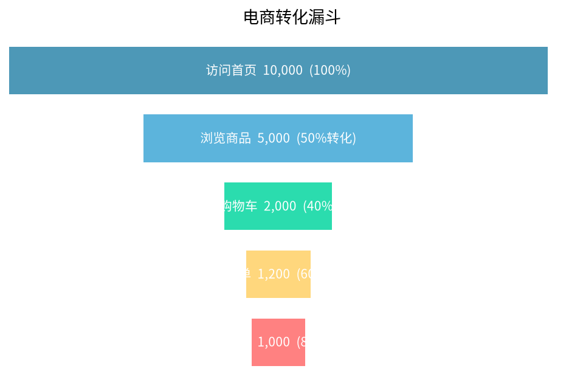
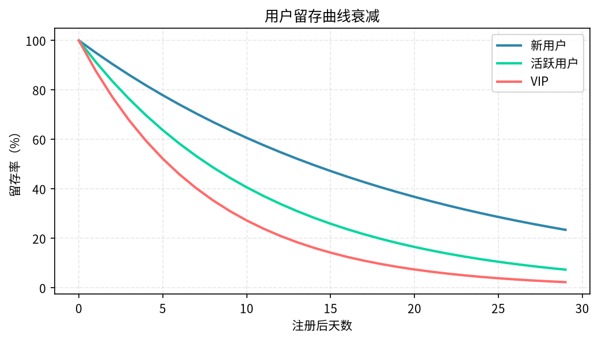
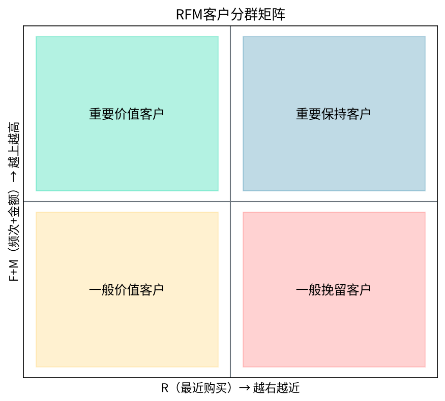

# 第09章 业务数据分析方法论

> 工具是手段，业务理解才是核心。本章讲最常用的业务分析框架：指标体系、漏斗、留存、RFM、杜邦分析。

---

## 9.1 指标体系搭建

### 9.1.1 北极星指标

**北极星指标**：最能反映产品核心价值的那一个指标。

| 产品类型 | 北极星指标 |
|----------|-----------|
| 电商 | GMV / 付费用户数 |
| 社交 | DAU / 每日消息发送量 |
| 工具 | 周活跃用户数 |
| 内容 | 日均阅读时长 |
| SaaS | 月度经常性收入（MRR） |

**好的北极星指标的特征：**
- 反映用户获得的价值
- 和公司收入正相关
- 可分解、可影响
- 是领先指标，不是滞后指标

### 9.1.2 AARRR指标体系

```
Acquisition（获客）
├── 下载量 / 注册量
├── 获客成本 CAC
└── 各渠道转化率

Activation（激活）
├── 首次核心行为完成率
├── Onboarding完成率
└── 首日留存

Retention（留存）
├── 次日/7日/30日留存率
├── DAU/MAU（粘性）
└── 用户生命周期 LTV

Revenue（营收）
├── ARPU（每用户平均收入）
├── 付费率
├── 客单价
└── 复购率

Referral（传播）
├── K因子
├── 分享率
└── 邀请转化率
```

### 9.1.3 指标拆解的MECE方法

**GMV拆解：**

```
GMV = 流量 × 转化率 × 客单价
    = (DAU × 访问购买比例) × 转化率 × 客单价
    = ...
```

**用户数拆解：**

```
总用户 = 新用户 + 老用户
       = 新增（来自各渠道） + 活跃老用户
       = ...
```

---

## 9.2 漏斗分析

### 9.2.1 标准漏斗

```
步骤1：浏览商品  100,000 UV  100%
步骤2：加入购物车  15,000 UV   15%
步骤3：发起结算    5,000 UV    5%
步骤4：完成支付    3,000 UV    3%
```

**关键指标：**
- 整体转化率：3%（从浏览到支付）
- 各步转化率：15%、33%、60%
- 最大流失步：加入购物车→发起结算（流失67%）

### 9.2.2 漏斗分析要点

1. **按渠道分漏斗**：不同渠道的用户质量不同
2. **按新老用户分漏斗**：新用户转化低是正常的
3. **按设备分漏斗**：iOS和Android可能差异很大
4. **不要只看UV**：有些人会反复浏览，PV/UV也要看

### 9.2.3 SQL实现

```sql
WITH funnel AS (
    SELECT 
        user_id,
        MAX(CASE WHEN event = 'view_product' THEN 1 ELSE 0 END) AS step1_view,
        MAX(CASE WHEN event = 'add_cart' THEN 1 ELSE 0 END) AS step2_cart,
        MAX(CASE WHEN event = 'create_order' THEN 1 ELSE 0 END) AS step3_order,
        MAX(CASE WHEN event = 'pay_success' THEN 1 ELSE 0 END) AS step4_pay
    FROM user_behavior_log
    WHERE dt = '2026-10-01'
    GROUP BY user_id
)
SELECT 
    SUM(step1_view) AS step1_uv,
    SUM(step2_cart) AS step2_uv,
    SUM(step3_order) AS step3_uv,
    SUM(step4_pay) AS step4_uv,
    SUM(step2_cart) * 1.0 / SUM(step1_view) AS step1_to_step2,
    SUM(step3_order) * 1.0 / SUM(step2_cart) AS step2_to_step3,
    SUM(step4_pay) * 1.0 / SUM(step3_order) AS step3_to_step4
FROM funnel;
```



---

## 9.3 留存分析

### 9.3.1 什么是留存

**留存率**：某一天新增的用户，在之后第N天还回来的比例。

```
注册日（Day 0）：1000个新用户
Day 1：  350人回来 → 次日留存 35%
Day 7：  200人回来 → 7日留存 20%
Day 30： 100人回来 → 30日留存 10%
```

### 9.3.2 留存曲线

- **好的留存曲线**：下降到一定程度后平稳（说明有一批核心用户）
- **差的留存曲线**：一直下降，最后趋近于0（说明用户用完就走）

### 9.3.3 影响留存的关键因素

1. **产品核心价值**：用户为什么留下来？
2. **Onboarding体验**：新用户第一周的体验决定了长期留存
3. **推送/召回**：Push、短信、邮件召回效果
4. **内容新鲜度**：内容类产品每天有没有新东西



---

## 9.4 RFM用户分层

### 9.4.1 RFM定义

| 维度 | 含义 | 计算方式 |
|------|------|----------|
| R (Recency) | 最近一次消费距今多少天 | 越近越好 |
| F (Frequency) | 一段时间内消费了几次 | 越多越好 |
| M (Monetary) | 一段时间内消费了多少钱 | 越高越好 |

### 9.4.2 8类用户分层

| R | F | M | 用户类型 | 运营策略 |
|---|---|---|----------|----------|
| 高 | 高 | 高 | 重要价值用户 | VIP服务、专属客服 |
| 高 | 低 | 高 | 重要发展用户 | 提升购买频次 |
| 低 | 高 | 高 | 重要保持用户 | 主动召回 |
| 低 | 低 | 高 | 重要挽留用户 | 大额优惠券 |
| 高 | 高 | 低 | 一般价值用户 | 提升客单价 |
| 高 | 低 | 低 | 一般发展用户 | 引导复购 |
| 低 | 高 | 低 | 一般保持用户 | 激活召回 |
| 低 | 低 | 低 | 一般挽留用户 | 低成本触达 |



---

## 9.5 杜邦分析

### 9.5.1 拆解逻辑

```
ROE（净资产收益率）
= 净利率 × 总资产周转率 × 权益乘数
= (净利润/营收) × (营收/总资产) × (总资产/净资产)
```

每个因子再往下拆，就能定位问题出在哪里。

**例子：**
- 净利率下降 → 是成本上升还是降价促销？
- 周转率下降 → 是库存积压还是应收款增多？
- 权益乘数上升 → 是借了更多债？

---

## 9.6 本章小结

1. **北极星指标**是所有分析的锚点
2. **漏斗分析**找流失，**留存分析**看粘性，**RFM**做用户分层
3. **指标拆解**用MECE原则，一层一层拆到可执行
4. **分析不是目的**，驱动业务行动才是

> **下一章**：[第10章 A/B测试与因果推断](10-ab-testing-causal-inference.md) — 怎么证明"是这个改动带来的效果"，而不是其他因素？
