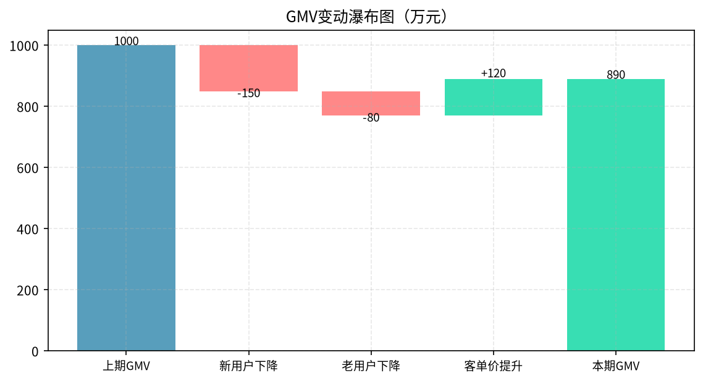
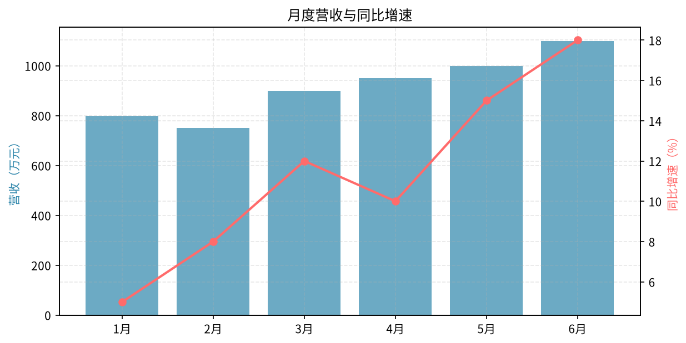

# 第12章 销售与营收分析

> 所有业务最终都要落到收入上。本章拆解GMV、客单价、复购率，以及同比环比的正确看法。

---

## 12.1 GMV拆解

### 12.1.1 经典拆解公式

```
GMV = 付费用户数 × 客单价
    = (DAU × 付费率) × 客单价
    = ...
```

**进一步拆：**
```
GMV = 流量 × 转化率 × 客单价 × 复购次数
```

每个因子都可以继续往下拆，直到能定位到具体问题。

### 12.1.2 拆解实战

**问题：本月GMV环比下降了10%，为什么？**

```
GMV = 付费用户数 × 客单价

付费用户数：上月10,000 → 本月9,500（-5%）
客单价：上月200元 → 本月190元（-5%）

再拆付费用户数：
  = 新付费用户 + 老付费用户
  新付费：上月3,000 → 本月2,500（-17%）← 主要问题
  老付费：上月7,000 → 本月7,000（持平）

再拆新付费用户：
  = 新注册用户 × 新用户付费率
  新注册：上月10,000 → 本月10,000（持平）
  新用户付费率：上月30% → 本月25%（-5pp）← 问题根源
```

**结论：** GMV下降主要是因为新用户付费率下降了5个百分点，而不是流量少了。



---

## 12.2 客单价分析

### 12.2.1 客单价拆解

```
客单价 = 件单价 × 连带率（每单买几件）
```

**提升客单价的方法：**
- 提升件单价：推高价商品
- 提升连带率：凑单满减、搭配推荐

### 12.2.2 价格带分析

```python
# 按价格带分布
df['价格带'] = pd.cut(df['商品价格'], 
                      bins=[0, 50, 100, 200, 500, 1000, float('inf')],
                      labels=['0-50', '50-100', '100-200', '200-500', '500-1000', '1000+'])

price_dist = df.groupby('价格带')['GMV'].sum()
print(price_dist)
```

---

## 12.3 复购分析

### 12.3.1 复购率计算

```
复购率 = 购买2次及以上的用户数 / 总购买用户数
```

**注意：**
- 时间窗口：是看一个月内复购？还是三个月？还是终身？
- 口径要统一，不同时间窗口的复购率差异很大

### 12.3.2 复购周期分析

```python
# 计算每个用户的两次购买间隔
user_orders = df.sort_values(['user_id', 'order_time'])
user_orders['prev_order'] = user_orders.groupby('user_id')['order_time'].shift(1)
user_orders['gap_days'] = (user_orders['order_time'] - user_orders['prev_order']).dt.days

# 分布
print(user_orders['gap_days'].describe())
```

---

## 12.4 同比与环比

### 12.4.1 什么时候用同比 vs 环比

| 对比方式 | 适用场景 | 不适用场景 |
|----------|----------|-----------|
| 环比 | 业务稳定，快速变化 | 有季节性、节假日 |
| 同比 | 有季节性、节假日 | 业务刚起步，没有去年同期 |

### 12.4.2 大促期间怎么看

- **不要用环比**：大促月和非大促月没有可比性
- **要用同比**：和去年同期大促比
- **还要看大促前后的蓄水/透支效应**



---

## 12.5 渠道分析

### 12.5.1 渠道质量评估

```
渠道质量 = 新增用户数 × 用户质量（留存/付费/LTV） / 获客成本（CAC）
```

**核心公式：LTV / CAC**
- < 1：亏钱
- 1-3：一般
- > 3：健康
- > 5：优质渠道，加大投入

---

## 12.6 本章小结

1. **GMV拆解**是营收分析的基本功，一层层拆到可执行
2. **客单价 = 件单价 × 连带率**，两个方向都能优化
3. **复购率**要明确时间窗口口径
4. **同比环比**要看场景，大促用同比
5. **渠道质量**看LTV/CAC比值

> **下一章**：[第13章 运营数据分析](13-operations-analysis.md) — 活动效果怎么评估？推送ROI怎么算？
