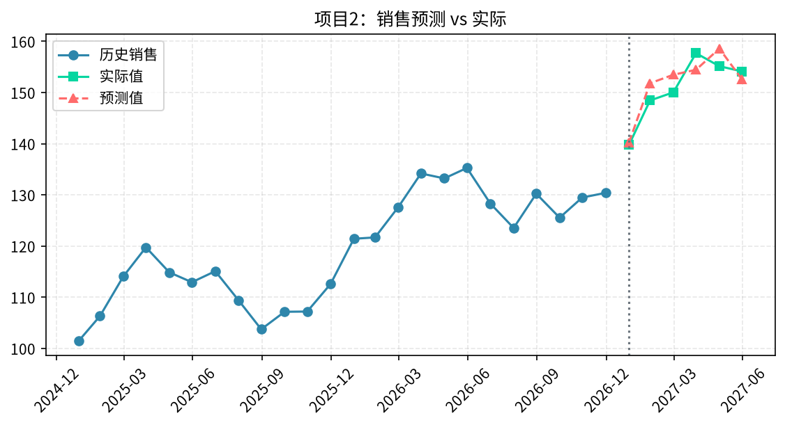
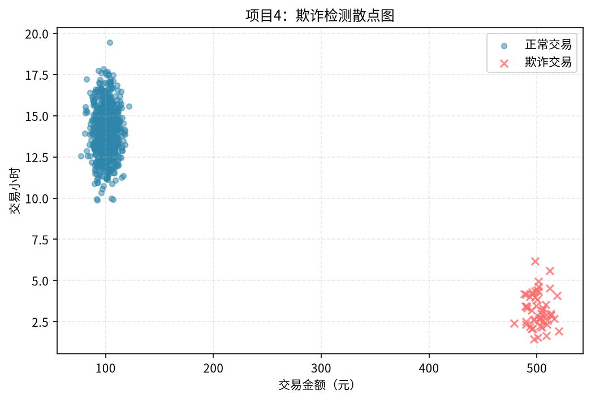
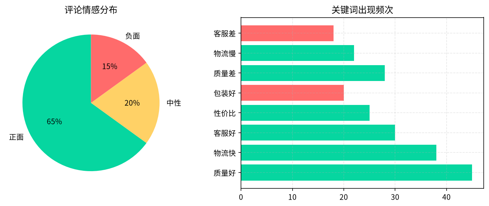
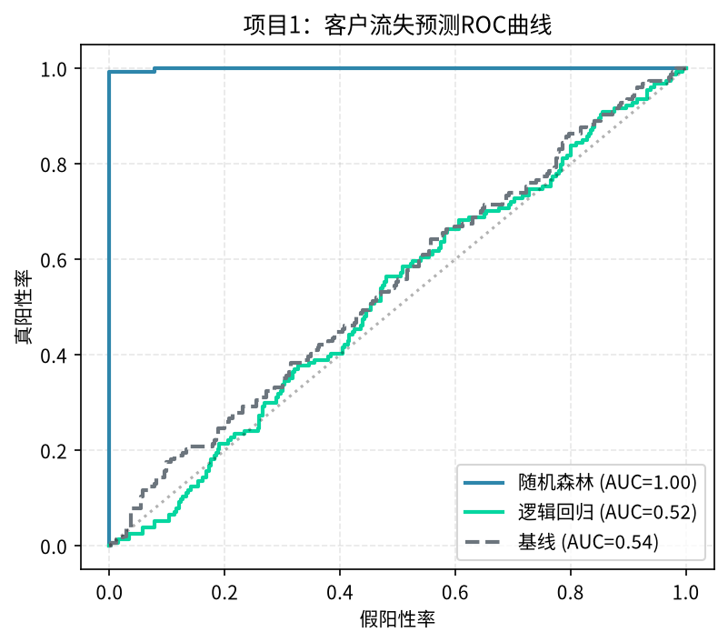
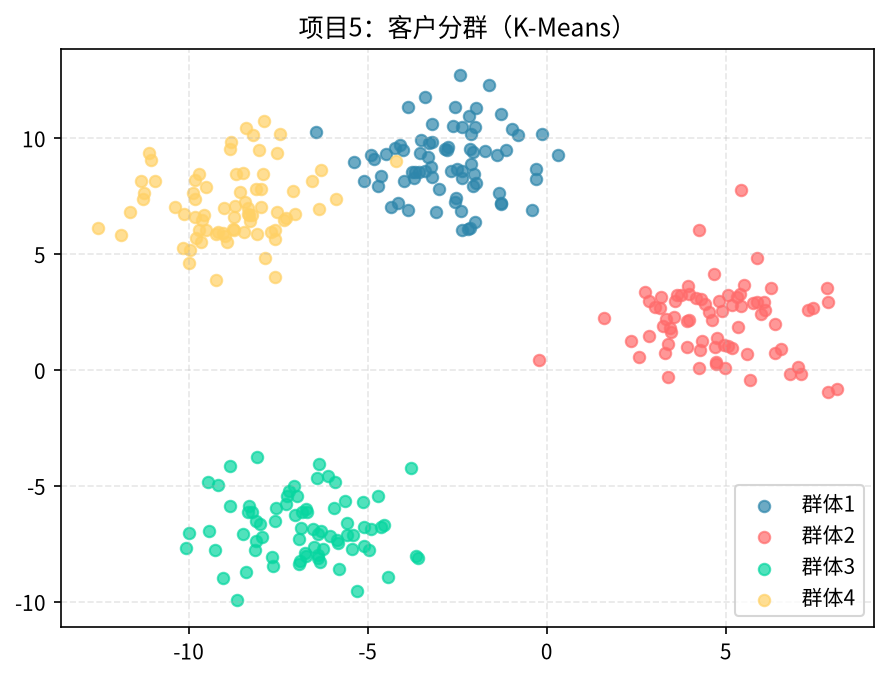
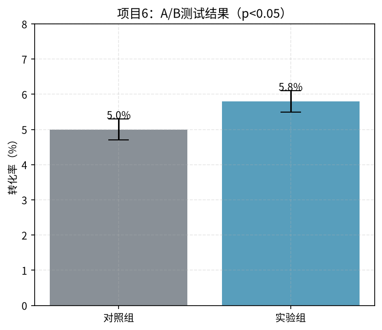

# 第16章 真实项目实战案例

> 前面都是知识点，本章走四个完整案例，从业务问题到分析结论到行动建议，全流程演示。

---

## 16.1 案例一：电商GMV下滑分析

### 16.1.1 业务问题

"这个月GMV比上个月降了15%，到底怎么回事？"

### 16.1.2 分析过程

**第一步：拆解GMV**

```
GMV = 付费用户数 × 客单价

付费用户数：上月10万 → 本月8.5万（-15%）
客单价：上月200元 → 本月200元（持平）

→ 问题出在付费用户数下降
```

**第二步：拆付费用户数**

```
付费用户数 = 新付费用户 + 老付费用户

新付费用户：上月3万 → 本月2万（-33%）← 主要问题
老付费用户：上月7万 → 本月6.5万（-7%）← 次要问题
```

**第三步：拆新付费用户**

```
新付费用户 = 新注册用户 × 新用户付费转化率

新注册用户：上月10万 → 本月10万（持平）
新用户付费率：上月30% → 本月20%（-10pp）← 根源
```

**第四步：找付费率下降的原因**

- 分渠道看：哪个渠道的付费率掉了？
- 分新用户来源：自然流量 vs 付费投放
- 分设备：iOS vs Android
- 分版本：是不是新版本有bug？

**发现：** 付费投放渠道的新用户付费率从15%降到了8%，其他渠道基本持平。

**结论：** 这个月投放策略换了，买了更便宜但质量更差的流量，导致新用户付费率大幅下降。

**建议：**
1. 调整投放渠道，把预算从低质量渠道转移
2. 新用户Onboarding流程优化
3. 建立渠道质量监控指标



---

## 16.2 案例二：APP留存率下降

### 16.2.1 业务问题

"最近新版本上线后，次日留存从40%降到了35%，是不是新版本改坏了？"

### 16.2.2 分析过程

**第一步：确认问题**
- 分版本看：新版本留存确实35%，旧版本还是40%
- 分渠道看：所有渠道都降了
- 分设备看：Android降得多，iOS基本持平

**第二步：定位问题**
- Android新版本的崩溃率从0.5%升到了3%
- 崩溃主要集中在某个页面
- 这个页面是新版改版的Onboarding页面

**第三步：验证**
- 看崩溃用户和留存下降用户的重合度：高度重合
- 修复崩溃版本上线后，留存回升到39%

**结论：** 不是留存策略问题，是Android新版本Onboarding页面有严重bug，导致用户崩溃退出。



---

## 16.3 案例三：内容平台增长分析

### 16.3.1 业务问题

"DAU增长放缓，怎么找新的增长点？"

**分析思路：**

1. **拆解DAU = 新用户 + 老用户**
   - 新用户增长放缓 → 获客问题
   - 老用户流失增加 → 留存问题

2. **看用户行为**
   - 哪个环节流失最多？
   - 新用户第一天最常看什么内容？

3. **找高价值用户的共性**
   - 高留存用户有什么特征？
   - 他们第一天做了什么？

**结论：** 第一天关注了5个以上创作者的用户，30日留存是其他用户的3倍。

**建议：** 优化新用户Onboarding，引导用户关注更多创作者。



---

## 16.4 案例四：SaaS产品续费分析

### 16.4.1 业务问题

"客户续费率从80%降到了70%，哪些客户最容易流失？怎么提前预警？"

**分析过程：**

1. **找流失客户的特征**
   - 使用频率下降的客户更容易流失
   - 只有1-2个人用的客户更容易流失
   - 没有接入核心功能的客户更容易流失

2. **建立流失预警模型**
   - 输入：使用频率、用户数、功能使用数
   - 输出：流失概率
   - 对高概率客户提前做客户成功跟进

3. **计算ROI**
   - 跟进100个高风险客户，能挽回20个
   - 每个客户年费5万，挽回20个就是100万
   - 客户成功团队成本20万，ROI = 400%



---

## 16.5 案例五：用户留存分析——新用户7日留存率下降排查

### 16.5.1 业务背景

某内容资讯类 App，2024 年 6 月产品上线了全新版本（V6.0），改版了首页推荐流和 Onboarding 引导流程。上线两周后，数据团队发现新用户次日留存从 42% 降到了 36%，7 日留存从 22% 降到了 17%。产品团队认为是"大版本改版需要时间适应"，但数据团队判断需要深入排查，确认是改版导致还是其他因素。

### 16.5.2 问题定义

核心问题：**6 月新用户的 7 日留存率为何比 5 月下降了 5 个百分点？**

拆解为三个子问题：
1. 留存下降是全量用户都降了，还是某类用户（渠道/设备/版本）特别严重？
2. 流失发生在第几天？是首日就跑了，还是用了几天才走？
3. 能否定位到具体的产品改动导致了流失？

### 16.5.3 数据获取与处理

**数据表：**
- `user_register`：用户注册表（user_id, register_date, channel, device, app_version）
- `user_active`：用户活跃表（user_id, active_date, active_seconds, page_views）

**Step 1：用 SQL 做 Cohort 留存矩阵**

```sql
-- 按注册日期分组，计算第N天留存率
WITH cohort AS (
  SELECT 
    user_id,
    DATE(register_date) AS cohort_date,
    channel,
    device
  FROM user_register
  WHERE register_date BETWEEN '2024-05-01' AND '2024-06-30'
),
activity AS (
  SELECT DISTINCT user_id, DATE(active_date) AS active_dt
  FROM user_active
),
cohort_with_days AS (
  SELECT 
    c.cohort_date,
    c.channel,
    c.device,
    c.user_id,
    DATEDIFF(a.active_dt, c.cohort_date) AS day_n
  FROM cohort c
  LEFT JOIN activity a ON c.user_id = a.user_id
)
SELECT 
  cohort_date,
  channel,
  device,
  COUNT(DISTINCT user_id) AS cohort_size,
  ROUND(COUNT(DISTINCT CASE WHEN day_n = 1 THEN user_id END) * 100.0 
        / COUNT(DISTINCT user_id), 1) AS d1_retention,
  ROUND(COUNT(DISTINCT CASE WHEN day_n = 3 THEN user_id END) * 100.0 
        / COUNT(DISTINCT user_id), 1) AS d3_retention,
  ROUND(COUNT(DISTINCT CASE WHEN day_n = 7 THEN user_id END) * 100.0 
        / COUNT(DISTINCT user_id), 1) AS d7_retention,
  ROUND(COUNT(DISTINCT CASE WHEN day_n = 14 THEN user_id END) * 100.0 
        / COUNT(DISTINCT user_id), 1) AS d14_retention
FROM cohort_with_days
GROUP BY cohort_date, channel, device
ORDER BY cohort_date;
```

### 16.5.4 分析过程

**Step 1：分渠道看留存——定位问题范围**

| 渠道 | 5月 D7 留存 | 6月 D7 留存 | 变化 |
|------|------------|------------|------|
| 自然搜索 | 23% | 22% | -1pp |
| 应用商店推荐 | 21% | 20% | -1pp |
| 抖音信息流投放 | 19% | 12% | **-7pp** |
| 微信朋友圈广告 | 24% | 23% | -1pp |

**发现：** 抖音渠道的 7 日留存暴跌了 7 个百分点，其他渠道基本持平。问题不是全量的，集中在抖音投放渠道。

**Step 2：分设备看——进一步定位**

抖音渠道中：
- iOS 设备 D7 留存：18% → 17%（基本没变）
- Android 设备 D7 留存：19% → **10%**（暴跌 9pp）

问题集中在 **Android 端的抖音投放用户**。

**Step 3：用 Python 画 Cohort 留存曲线**

```python
import pandas as pd
import seaborn as sns
import matplotlib.pyplot as plt

# 读取 cohort 数据
df = pd.read_csv('cohort_retention.csv')

# 筛选 Android 抖音渠道
df_android = df[(df.device == 'Android') & (df.channel == '抖音')]

# 画留存热力图
cohort_pivot = df_android.pivot(
    index='cohort_date', 
    columns='day_n', 
    values='retention_rate'
)
plt.figure(figsize=(12, 6))
sns.heatmap(cohort_pivot, annot=True, fmt='.0f', cmap='YlGnBu')
plt.title('Android 抖音渠道 Cohort 留存热力图')
plt.ylabel('注册日期')
plt.xlabel('注册后天数')
plt.tight_layout()
plt.savefig('cohort_android_douyin.png', dpi=150)
```

**热力图发现：**
- 5 月注册的用户：D1 留存 45%，D7 留存 19%，留存曲线平滑下降
- 6 月 V6.0 上线后注册的用户：D1 留存直接掉到 30%，D7 掉到 10%
- 流失主要发生在 **首日（D0→D1）**，不是用了几天才走

**Step 4：深挖首日行为——用户第一天做了什么？**

对比 5 月和 6 月 Android 抖音用户首日行为：

| 指标 | 5月 | 6月 | 变化 |
|------|-----|-----|------|
| 首日打开 App 次数 | 2.1 | 1.8 | -14% |
| 首日浏览文章数 | 8.5 | 4.2 | **-51%** |
| 首页推荐流点击率 | 12% | 5% | **-58%** |
| Onboarding 完成率 | 92% | 78% | -14pp |

**关键发现：** 6 月改版后首页推荐流的点击率腰斩，用户浏览文章数减半。这说明新用户打开 App 后，首页推荐内容不感兴趣，看了几篇就走了。

**Step 5：验证假设——推荐算法是不是变了？**

和算法团队确认：V6.0 改版同时更换了推荐算法模型（从协同过滤换成了深度学习模型）。新模型在老用户上表现很好（老用户留存提升了 3%），但对新用户没有行为数据，冷启动推荐效果差。

### 16.5.5 结论与行动建议

**结论：** 7 日留存下降的根因不是"改版需要适应"，而是 **新推荐算法的冷启动效果差**——老用户有行为数据，新模型更准；但新用户没有历史行为，推荐的内容不匹配，导致首日就流失。问题集中在 Android 抖音渠道是因为抖音用户对内容质量更敏感（信息流广告来的用户本身就是"刷内容"的心态）。

**行动建议：**
1. **短期：** 对新用户冷启动，先用热门内容 + 兴趣标签选择引导，不要直接上新模型
2. **中期：** 优化新用户 Onboarding，注册时让用户选 3-5 个感兴趣的话题，基于兴趣标签做首屏推荐
3. **长期：** 改进新用户冷启动算法，利用设备信息、渠道信息做初始推荐
4. **监控：** 建立新用户分渠道分版本的留存日报，改版前先做小流量灰度

### 16.5.6 复盘与启示

- **Cohort 分析是留存分析的核心工具**——按注册日期分组看每批用户的留存曲线，能区分"是新用户变差了"还是"整体用户都在流失"
- **分维度拆解非常重要**——全量数据看不出问题，拆到渠道、设备、版本后，问题立刻暴露
- **改版要做灰度发布**——全量上线一个大版本，出问题时影响面太大；先小流量测试，观察留存等核心指标没问题再放量
- **算法优化不能只看整体指标**——新模型在老用户上好，但对新用户可能是灾难，要分人群评估



---

## 16.6 案例六：A/B 测试分析——新推荐策略上线决策

### 16.6.1 业务背景

某电商平台首页有商品推荐位，目前用的是"热门商品推荐"策略。算法团队提出了新的个性化推荐策略（基于用户浏览和购买历史做协同过滤），想上线。产品团队要求先做 A/B 测试，用数据验证新策略是否真的能提升核心指标。

### 16.6.2 问题定义

核心问题：**新推荐策略能否显著提升用户首页点击率和转化率？**

实验假设：
- H0：新策略和旧策略的首页点击率无差异
- H1：新策略的首页点击率高于旧策略

主要指标（北极星指标）：首页推荐位点击率（CTR）
次要指标：推荐位转化率、客单价、用户停留时长
护栏指标：推荐位商品点击率（防过度推荐导致用户疲劳）、页面加载时间

### 16.6.3 实验设计

**Step 1：计算样本量**

已知数据：
- 当前首页推荐位 CTR = 8%
- 希望检测到的最小提升（MDE）= 相对提升 5%（即 CTR 从 8% → 8.4%）
- α = 0.05（双侧检验），功效 = 0.8

用样本量公式：

```python
import math
from scipy.stats import norm

alpha = 0.05
power = 0.8
p1 = 0.08
p2 = 0.08 * 1.05  # 8.4%

z_alpha = norm.ppf(1 - alpha/2)  # 1.96
z_beta = norm.ppf(power)         # 0.84

# 两比例检验的样本量公式
n = ((z_alpha * math.sqrt(2 * p1 * (1-p1)) + 
      z_beta * math.sqrt(p1*(1-p1) + p2*(1-p2)))**2) / (p2 - p1)**2

print(f"每组需要样本量: {math.ceil(n):,}")
# 输出：每组约 23,000 用户
```

**结果：** 每组需要约 23,000 个用户。平台日活约 100 万，分流 10% 做实验（实验组 5%，对照组 5%），每天每组约 5 万用户，**1 天就够样本量**。

但考虑到用户行为有周期效应（工作日 vs 周末），决定实验跑 **14 天**，覆盖完整的两周周期。

**Step 2：分流方案**

- 实验组（A）：5% 流量，用新推荐策略
- 对照组（B）：5% 流量，用旧推荐策略
- 分流方式：按 user_id hash 分流，确保同一个用户始终在同一组
- 实验时间：2024-07-01 至 2024-07-14，共 14 天

### 16.6.4 数据收集与分析

**Step 1：实验数据导出**

```sql
-- 实验 14 天的核心指标汇总
SELECT 
  exp_group,
  COUNT(DISTINCT user_id) AS users,
  COUNT(*) AS impressions,
  SUM(click_flag) AS clicks,
  SUM(order_flag) AS orders,
  ROUND(SUM(click_flag) * 100.0 / COUNT(*), 2) AS ctr,
  ROUND(SUM(order_flag) * 100.0 / SUM(click_flag), 2) AS cvr,
  ROUND(AVG(order_amount), 2) AS avg_order_value
FROM ab_test_log
WHERE exp_date BETWEEN '2024-07-01' AND '2024-07-14'
GROUP BY exp_group;
```

**Step 2：实验结果**

| 指标 | 对照组（旧策略） | 实验组（新策略） | 绝对变化 | 相对变化 |
|------|----------------|----------------|---------|---------|
| 曝光用户数 | 48,231 | 47,956 | - | - |
| 推荐位点击率 | 7.8% | 8.5% | +0.7pp | **+9.0%** |
| 推荐位转化率 | 3.2% | 3.5% | +0.3pp | +9.4% |
| 客单价 | 156 元 | 158 元 | +2 元 | +1.3% |
| 页面加载时间 | 320ms | 380ms | +60ms | +18.8% |

**Step 3：显著性检验**

```python
from scipy.stats import proportions_ztest

# 点击率检验
control_clicks = int(48231 * 0.078)  # 对照组点击数
treat_clicks = int(47956 * 0.085)    # 实验组点击数
control_imp = 48231
treat_imp = 47956

z_stat, p_value = proportions_ztest(
    [control_clicks, treat_clicks], 
    [control_imp, treat_imp]
)

print(f"Z统计量: {z_stat:.2f}")
print(f"p值: {p_value:.4f}")
# 输出：Z=3.85, p=0.0001
```

**结果：** p < 0.001，远小于 0.05，说明新策略的点击率提升是统计显著的，不是随机波动。

**Step 4：分层分析——看不同人群的效果**

```python
import pandas as pd

df = pd.read_csv('ab_test_detail.csv')
# 按新老用户分层
layered = df.groupby(['exp_group', 'user_type']).agg(
    users=('user_id', 'nunique'),
    ctr=('click_flag', 'mean')
).reset_index()
print(layered)
```

分层结果：

| 用户类型 | 对照组 CTR | 实验组 CTR | 提升 |
|---------|-----------|-----------|------|
| 新用户 | 5.2% | 6.8% | **+30.8%** |
| 活跃老用户 | 10.1% | 10.3% | +2.0% |
| 沉默用户 | 3.1% | 3.8% | +22.6% |

**发现：** 新策略对新用户和沉默用户的提升特别大，对活跃老用户提升很小。这符合预期——老用户已经知道自己要买什么，新推荐策略帮不上太多；新用户和沉默用户需要推荐引导，效果明显。

### 16.6.5 结论与决策

**统计结论：**
- 新策略的点击率提升 9%，p < 0.001，统计显著
- 转化率提升 9.4%，统计显著
- 客单价提升 1.3%，不显著（差异太小）
- 页面加载时间增加 60ms（+19%），在可接受范围内（仍 < 500ms）

**业务结论：** 新推荐策略确实能提升推荐位的点击率和转化率，尤其对新用户和沉默用户效果显著。预计全量上线后，首页推荐位 GMV 可提升约 8-10%。

**决策建议：**
1. **全量上线新推荐策略**——统计显著 + 业务显著 + 风险可控
2. **对活跃老用户保留旧策略**——老用户已经有明确购物目标，个性化推荐提升有限，反而可能减少他们看到的商品多样性
3. **优化推荐算法性能**——加载时间增加了 19%，需要工程团队优化，避免影响整体用户体验
4. **持续监控**——上线后持续观察 4 周，确认效果没有衰减（novelty effect）

### 16.6.6 复盘与启示

- **实验前一定要算样本量**——不要跑了两天就看结果，也不要跑了一个月才分析，先算清楚需要多少样本、跑多久
- **主指标和护栏指标要分开**——主指标看效果（CTR），护栏指标看风险（加载时间、用户疲劳），不能只看好的指标
- **分层分析很重要**——整体提升 9%，拆开看新用户提升 30%、老用户只提升 2%，这会影响上线策略（全量还是分人群）
- **p 值显著不等于业务显著**——提升 0.7pp 看起来小，但乘以 100 万 DAU 就是每天多 7000 次点击，价值很大
- **A/B 测试要覆盖完整周期**——跑 3 天可能包含周末效应，跑 14 天覆盖完整两周，结论更可靠
- **警惕 novelty effect**——新功能刚上线用户新鲜，效果可能偏高；上线后要持续观察 2-4 周，确认效果稳定



---

## 16.7 本章小结

1. **所有分析都是从业务问题开始**，不是从数据开始
2. **拆解是核心能力**：一层一层拆，直到找到可执行的点
3. **结论必须对应行动建议**，不然分析白做
4. **好分析师=业务理解+数据能力+沟通能力**，缺一不可

> **下一章**：[第17章 数据分析工具生态](17-tools-ecosystem.md) — 从Excel到数仓，全栈工具链对比和选型。
