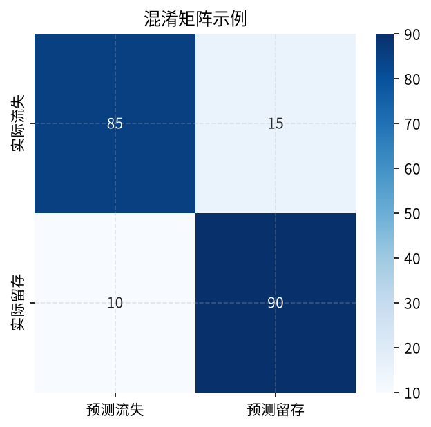
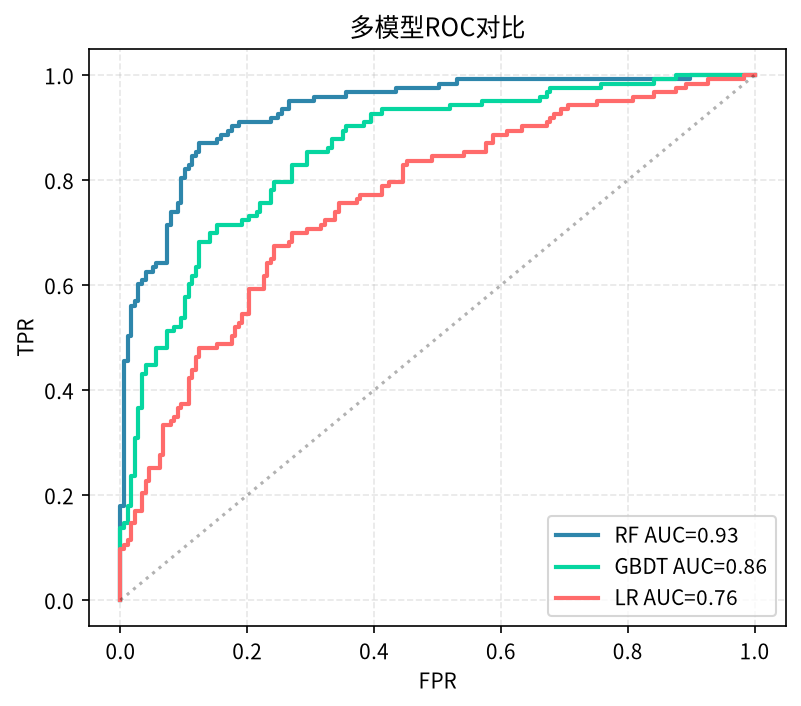

# 第22章 监督学习：分类算法

> 分类是分析师最常遇到的预测任务：用户会不会流失？这笔交易是不是欺诈？这封邮件是不是垃圾邮件？本章把主流分类算法、评估指标和实战流程一次讲透。

---

## 22.1 分类问题概述

### 22.1.1 什么是分类

分类（Classification）属于监督学习：训练数据里既有特征 X，也有标签 y，模型的目标是学会一个映射 f(X) → y。和回归的区别在于，分类的 y 是**离散的类别**，回归的 y 是连续数值。

### 22.1.2 三种常见分类场景

| 类型 | 标签示例 | 典型算法输出 |
|------|----------|--------------|
| 二分类 | 是否流失、是否欺诈、是否点击 | 正类概率 P(y=1\|X) |
| 多分类 | 邮件分类（工作/个人/广告）、鸢尾花品种 | 每个类别的概率向量 |
| 多标签 | 一篇文章同时属于"科技""AI" | 每个标签独立的 0/1 |

**关键提醒：** 二分类里一定要搞清楚"正类"（positive）是哪一边。在风控场景，正类通常是"欺诈/坏客户"，样本占比往往不到 1%；在营销转化场景，正类是"购买"，占比可能只有 2%。类别不平衡是分类任务的默认状态，而不是例外。

---

## 22.2 逻辑回归

### 22.2.1 核心原理

逻辑回归（Logistic Regression）虽然名字里带"回归"，但它是**分类算法**。它的做法是：先用线性组合算一个对数几率（log-odds），再通过 sigmoid 函数压到 (0,1) 之间变成概率：

$$
z = w_0 + w_1 x_1 + \dots + w_n x_n
$$

$$
P(y=1 \mid X) = \frac{1}{1 + e^{-z}}
$$

### 22.2.2 代码实现

```python
from sklearn.linear_model import LogisticRegression
from sklearn.datasets import load_breast_cancer
from sklearn.model_selection import train_test_split
from sklearn.preprocessing import StandardScaler

data = load_breast_cancer()
X, y = data.data, data.target
X_train, X_test, y_train, y_test = train_test_split(
    X, y, test_size=0.2, random_state=42
)

# 逻辑回归对尺度敏感，必须标准化
scaler = StandardScaler()
X_train_s = scaler.fit_transform(X_train)
X_test_s = scaler.transform(X_test)

clf = LogisticRegression(max_iter=1000)
clf.fit(X_train_s, y_train)

print("训练集准确率:", clf.score(X_train_s, y_train))
print("测试集准确率:", clf.score(X_test_s, y_test))
```

### 22.2.3 系数解释

逻辑回归的系数可以直接读成"对数几率的变化"——这是它相对于树模型最大的优势。系数每增加 1，对应特征增加一个单位时， odds 乘以 e^w。

```python
import pandas as pd
coef = pd.DataFrame({
    'feature': data.feature_names,
    'coef': clf.coef_[0]
}).sort_values('coef', key=abs, ascending=False)
print(coef.head(10))
```

**解读方式：** 系数为正且绝对值大的特征，会显著提高"恶性肿瘤"的概率；为负的则相反。这种可解释性让逻辑回归在医疗、金融合规场景几乎是默认选择。

### 22.2.4 概率校准

逻辑回归本身输出的就是合理概率，但如果你把它换成树模型再做"概率"输出，往往会很极端（接近 0 或 1）。可以用 `CalibratedClassifierCV` 做校准：

```python
from sklearn.calibration import CalibratedClassifierCV
calibrated = CalibratedClassifierCV(clf, cv=5, method='isotonic')
calibrated.fit(X_train_s, y_train)
```

---

## 22.3 决策树分类

### 22.3.1 分裂准则

决策树通过反复分裂节点来分类，每次分裂选择"最能降低不确定性"的特征和阈值。两种主流准则：

- **信息增益（ID3/C4.5）**：基于熵，熵 = -p log p - (1-p) log(1-p)
- **基尼系数（CART）**：Gini = 1 - p² - (1-p)²，计算更快，sklearn 默认用它

### 22.3.2 代码与可解释性

```python
from sklearn.tree import DecisionTreeClassifier, plot_tree
import matplotlib.pyplot as plt

tree = DecisionTreeClassifier(max_depth=3, random_state=42)
tree.fit(X_train, y_train)

plt.figure(figsize=(14, 6))
plot_tree(tree, feature_names=data.feature_names,
          class_names=data.target_names, filled=True)
plt.show()
```

**决策树的杀手锏是可解释性**：你能直接画出"如果半径 > 14 且纹理 > 18，则大概率恶性"这样的规则。这在监管要求高的场景（信贷审批、医疗诊断）非常值钱。

但单棵决策树容易过拟合，所以更实用的是它的集成版本——随机森林和梯度提升树。

---

## 22.4 随机森林

### 22.4.1 Bagging 思想

随机森林（Random Forest）= 几百棵互相独立的决策树投票。"随机"体现在两层：每棵树用 bootstrap 抽样（有放回），每次分裂只考虑一部分特征。这样不同树之间差异大，投票后方差显著降低。

### 22.4.2 代码

```python
from sklearn.ensemble import RandomForestClassifier

rf = RandomForestClassifier(
    n_estimators=200,      # 树的数量
    max_depth=None,        # 不限制深度，靠随机化防过拟合
    min_samples_leaf=5,
    random_state=42,
    n_jobs=-1
)
rf.fit(X_train, y_train)
print("随机森林测试准确率:", rf.score(X_test, y_test))
```

### 22.4.3 特征重要性

```python
imp = pd.DataFrame({
    'feature': data.feature_names,
    'importance': rf.feature_importances_
}).sort_values('importance', ascending=False)
print(imp.head(10))
```

**要点：** 随机森林几乎不需要调参，对特征尺度不敏感，能输出特征重要性——这是分析师最爱用它的原因。它的缺点是预测结果是"黑盒"，概率输出也不够校准。

---

## 22.5 梯度提升树

### 22.5.1 从 AdaBoost 到 XGBoost

梯度提升树（Gradient Boosting Decision Tree, GBDT）和随机森林的思路完全不同：**一棵树接一棵树，每棵新树专门去拟合上一轮预测的残差**。这是目前表格数据竞赛和工业界的默认王者。

主流实现对比：

| 算法 | 特点 | 适用场景 |
|------|------|----------|
| AdaBoost | 调整样本权重 | 教学用，工业少 |
| GBDT (sklearn) | 原生梯度提升 | 小数据、教学 |
| XGBoost | 二阶导、正则化、缺失值处理 | 通用、Kaggle 老牌 |
| LightGBM | 直方图算法、leaf-wise、速度快 | 大数据、高维 |
| CatBoost | 原生类别特征处理 | 类别特征多的场景 |

### 22.5.2 XGBoost 示例

```python
import xgboost as xgb

model = xgb.XGBClassifier(
    n_estimators=300,
    max_depth=4,
    learning_rate=0.05,
    subsample=0.8,
    colsample_bytree=0.8,
    random_state=42,
    use_label_encoder=False,
    eval_metric='logloss'
)
model.fit(X_train, y_train,
          eval_set=[(X_test, y_test)],
          early_stopping_rounds=20,
          verbose=False)

print("最佳迭代轮数:", model.best_iteration)
print("测试集 AUC:", model.score(X_test, y_test))
```

**调参经验：** 学习率小一点（0.01~0.1）+ 树多一点，通常比学习率大+树少更稳；`max_depth` 控制在 3~7 之间；用 `early_stopping_rounds` 自动停在最佳轮数。

---

## 22.6 SVM、KNN、朴素贝叶斯简介

### 22.6.1 SVM（支持向量机）

寻找一个最优超平面把两类分开，核技巧（RBF、多项式）能处理非线性。在小样本、高维（如文本）场景曾经很流行，但现在基本被 GBDT 和深度学习取代。

```python
from sklearn.svm import SVC
svm = SVC(kernel='rbf', C=1.0, probability=True)
svm.fit(X_train_s, y_train)  # SVM 必须标准化
```

### 22.6.2 KNN（K 近邻）

"近朱者赤"：新来的样本看它周围 k 个邻居多数是什么类别。实现极简，但预测慢（要算距离）、对尺度敏感、高维下失效。适合作为基线或小数据。

### 22.6.3 朴素贝叶斯

基于贝叶斯定理 + "特征之间条件独立"的强假设。文本分类（垃圾邮件）的老牌算法，速度极快，可解释。缺点是独立性假设通常不成立，概率输出粗糙。

```python
from sklearn.naive_bayes import GaussianNB
nb = GaussianNB().fit(X_train, y_train)
```

---

## 22.7 分类评估指标

### 22.7.1 混淆矩阵

二分类的所有预测结果可以排成一个 2×2 表格：

|  | 预测：正 | 预测：负 |
|--|----------|----------|
| **实际：正** | TP（真正例） | FN（假负例） |
| **实际：负** | FP（假正例） | TN（真负例） |

```python
from sklearn.metrics import confusion_matrix, ConfusionMatrixDisplay
y_pred = rf.predict(X_test)
cm = confusion_matrix(y_test, y_pred)
print(cm)
```



### 22.7.2 四大核心指标

- **准确率 Accuracy** = (TP+TN) / 全部。类别不平衡时这个指标会骗人——99% 的负类，全预测负类准确率也有 99%。
- **精确率 Precision** = TP / (TP+FP)。预测为正的样本里，有多少真是正的。风控场景重视它（别把好客户误判成欺诈）。
- **召回率 Recall（灵敏度）** = TP / (TP+FN)。所有真实正类里，被找出来多少。营销/医疗重视它（别漏掉真病人）。
- **F1** = 精确率和召回率的调和平均。两者都要顾及时用。

### 22.7.3 ROC-AUC 与 PR-AUC

```python
from sklearn.metrics import roc_auc_score, average_precision_score
y_prob = rf.predict_proba(X_test)[:, 1]
print("ROC-AUC:", roc_auc_score(y_test, y_prob))
print("PR-AUC:", average_precision_score(y_test, y_prob))
```

**经验法则：**
- 类别相对均衡 → 看 ROC-AUC
- 正负类比例悬殊（1:100 以上）→ 看 PR-AUC，ROC-AUC 会虚高



---

## 22.8 类别不平衡处理

### 22.8.1 三种主流方案

1. **欠采样（Under-sampling）**：减少多数类样本。简单但丢信息。
2. **过采样（Over-sampling）**：复制少数类样本。容易过拟合。
3. **SMOTE**：在少数类样本之间插值合成新样本，比简单复制聪明。

```python
from imblearn.over_sampling import SMOTE
sm = SMOTE(random_state=42)
X_res, y_res = sm.fit_resample(X_train, y_train)
print("原始类别分布:", pd.Series(y_train).value_counts().to_dict())
print("SMOTE后分布:", pd.Series(y_res).value_counts().to_dict())
```

### 22.8.2 不重采样也能解决的两种办法

- **class_weight='balanced'**：让模型在训练时自动给少数类更大权重，sklearn 大部分分类器都支持。
- **阈值调整**：默认阈值 0.5 不一定合适。你可以画 PR 曲线，根据业务成本（误杀一个好客户 vs 漏掉一个欺诈）选一个最优阈值。

**要点：** 不要一上来就重采样。先在原数据上用 class_weight 跑一版，再和 SMOTE 对比，重采样只在你确认它能提升测试集表现时才用。

---

## 22.9 实战：完整分类项目

下面用 sklearn 自带的乳腺癌数据集，跑一个从数据到模型到解释的完整流程：

```python
import pandas as pd
import numpy as np
from sklearn.datasets import load_breast_cancer
from sklearn.model_selection import train_test_split, cross_val_score
from sklearn.preprocessing import StandardScaler
from sklearn.linear_model import LogisticRegression
from sklearn.ensemble import RandomForestClassifier
from sklearn.metrics import (classification_report, roc_auc_score,
                             confusion_matrix)

# 1. 加载数据
data = load_breast_cancer()
X = pd.DataFrame(data.data, columns=data.feature_names)
y = pd.Series(data.target)
print("样本数:", len(X), "特征数:", X.shape[1])
print("类别分布:", y.value_counts().to_dict())

# 2. 划分（注意 stratify 保证两类比例一致）
X_train, X_test, y_train, y_test = train_test_split(
    X, y, test_size=0.2, random_state=42, stratify=y
)

# 3. 标准化（逻辑回归、SVM 必须）
scaler = StandardScaler()
X_train_s = scaler.fit_transform(X_train)
X_test_s = scaler.transform(X_test)

# 4. 跑两个模型对比
models = {
    'Logistic Regression': LogisticRegression(max_iter=1000),
    'Random Forest': RandomForestClassifier(n_estimators=200, random_state=42)
}

for name, model in models.items():
    if name == 'Logistic Regression':
        model.fit(X_train_s, y_train)
        y_prob = model.predict_proba(X_test_s)[:, 1]
    else:
        model.fit(X_train, y_train)
        y_prob = model.predict_proba(X_test)[:, 1]
    y_pred = (y_prob > 0.5).astype(int)
    print(f"\n=== {name} ===")
    print(confusion_matrix(y_test, y_pred))
    print(classification_report(y_test, y_pred))
    print(f"ROC-AUC: {roc_auc_score(y_test, y_prob):.3f}")

# 5. 用随机森林看特征重要性
rf = models['Random Forest']
imp = pd.DataFrame({
    'feature': X.columns,
    'importance': rf.feature_importances_
}).sort_values('importance', ascending=False)
print("\nTop 5 重要特征:")
print(imp.head())
```

**业务解读思路：** 假设这个数据集是医院筛查，那么"radius_mean（平均半径）"和"concave points_mean（凹点数量）"排前两位——临床医生可以据此设计低成本的初筛问卷。

---

## 22.10 算法选择决策表

| 场景 | 首选算法 | 理由 |
|------|----------|------|
| 表格数据、追求效果 | XGBoost / LightGBM | 工业默认王 |
| 需要可解释、合规 | 逻辑回归 / 决策树 | 系数或规则可解释 |
| 特征尺度不一、不想做特征工程 | 随机森林 / LightGBM | 对尺度不敏感 |
| 类别极度不平衡 | XGBoost + class_weight 或 SMOTE | 原生支持权重 |
| 文本分类 | 朴素贝叶斯 / 线性 SVM / 嵌入 + MLP | 高维稀疏友好 |
| 小样本（< 1000） | 逻辑回归 / 线性 SVM | 复杂模型容易过拟合 |
| 大样本（百万级） | LightGBM / 逻辑回归（SGD） | 训练速度 |
| 想快速出基线 | 逻辑回归 + 随机森林 | 几行代码出结果 |

**常见坑提醒：**
1. 不要跳过 train_test_split 直接拿全量数据 fit——你会得到虚高的指标。
2. 一定要用 `stratify=y` 保证训练/测试集类别比例一致。
3. 树模型不需要标准化，线性模型/SVM/KNN 必须标准化。
4. 概率值不是预测值，业务上线前要校准。
5. 类别不平衡时别只看 accuracy。

---

## 22.11 本章小结

1. **分类 = 学一个从特征到离散标签的映射**，二分类、多分类、多标签是三种典型。
2. **逻辑回归**可解释强，系数即对数几率；**决策树**规则清晰；**随机森林**稳、抗过拟合、给特征重要性；**GBDT/XGBoost/LightGBM** 在表格数据上效果最好。
3. **评估指标**要和业务目标对齐：误杀成本高看精确率，漏判成本高看召回率，不平衡看 PR-AUC。
4. **类别不平衡**用 class_weight 优先，SMOTE 其次，重采样放最后。
5. 完整项目流程：划分 → 标准化 → 多模型对比 → 混淆矩阵 + AUC → 特征重要性 → 业务解读。

> **下一章**：[第23章 无监督学习：聚类与降维](23-unsupervised-clustering-dimred.md) — 没有标签时怎么办？把用户分群、把高维数据画出来。
