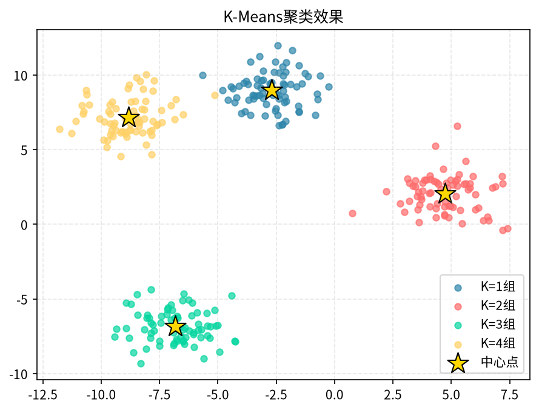
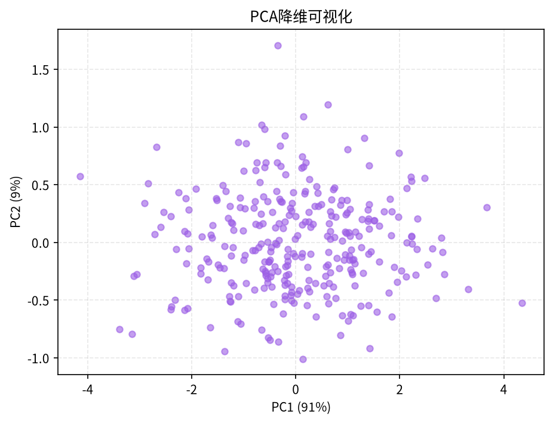

# 第23章 无监督学习：聚类与降维

> 有标签的问题总是少数。更多时候你面对的是一堆没有"答案"的数据——谁是高价值用户？这群人能不能分成几类？怎么把一百维的数据画在一张图上？本章讲两类最常用的无监督方法：聚类和降维。

---

## 23.1 为什么需要无监督学习

### 23.1.1 无监督 vs 监督

监督学习有 y（标签），模型学的是"X → y"的映射；无监督学习只有 X，模型自己去**发现结构**。它的价值在于：

1. **没有标签时也能动手**。用户是谁、分几类，业务方自己也未必说得清。
2. **辅助后续建模**。聚类结果可以作为新特征喂给监督模型。
3. **异常发现**。偏离主簇的样本往往就是异常（欺诈、设备故障）。
4. **高维可视化**。把几百维压到 2~3 维，画图看分布。

### 23.1.2 典型场景

- 用户分群（RFM、行为聚类）
- 商品/内容相似性分组
- 异常检测（CDN 流量、服务器日志）
- 高维数据可视化（基因、文档 embedding）

---

## 23.2 K-Means 聚类

### 23.2.1 原理

K-Means 是最经典的聚类算法，思路极简：

1. 选 K 个点当初始质心
2. 把每个样本分配给最近的质心
3. 重新计算每个簇的质心（簇内样本均值）
4. 重复 2-3 直到质心不再变动

它优化的目标是"所有样本到所属质心的距离平方和最小"（inertia）。

### 23.2.2 代码

```python
from sklearn.cluster import KMeans
from sklearn.preprocessing import StandardScaler
from sklearn.datasets import make_blobs
import matplotlib.pyplot as plt

# 造一份合成数据
X, _ = make_blobs(n_samples=500, centers=4, random_state=42)

# K-Means 对尺度敏感，必须先标准化
scaler = StandardScaler()
X_s = scaler.fit_transform(X)

kmeans = KMeans(n_clusters=4, random_state=42, n_init=10)
labels = kmeans.fit_predict(X_s)

plt.scatter(X_s[:, 0], X_s[:, 1], c=labels, cmap='tab10')
plt.scatter(kmeans.cluster_centers_[:, 0], kmeans.cluster_centers_[:, 1],
            marker='X', s=200, c='red')
plt.title("K-Means 聚类结果")
plt.show()
```



### 23.2.3 K 值怎么选

K 是超参数，必须人为指定。两种常用方法：

**肘部法（Elbow）：** 遍历 K=2~10，画 inertia 曲线，找"拐点"。

```python
inertias = []
for k in range(2, 11):
    km = KMeans(n_clusters=k, random_state=42, n_init=10)
    km.fit(X_s)
    inertias.append(km.inertia_)

plt.plot(range(2, 11), inertias, 'bo-')
plt.xlabel('K')
plt.ylabel('inertia')
plt.title('肘部图')
plt.show()
```

**轮廓系数（Silhouette）：** 同时衡量"簇内紧凑度"和"簇间分离度"，取值 [-1, 1]，越大越好。

```python
from sklearn.metrics import silhouette_score
for k in range(2, 11):
    km = KMeans(n_clusters=k, random_state=42, n_init=10)
    labels = km.fit_predict(X_s)
    print(f"K={k}, silhouette={silhouette_score(X_s, labels):.3f}")
```

### 23.2.4 优缺点

- 优点：快、简单、可扩展到百万样本。
- 缺点：必须预先指定 K；对初始质心敏感（sklearn 的 n_init=10 已经缓解）；**只能处理凸形簇**，遇到月牙形、环形会失败；对尺度敏感（必须标准化）；容易被离群点带偏质心。

---

## 23.3 层次聚类与 DBSCAN

### 23.3.1 层次聚类（Hierarchical）

不需要预先指定 K，通过"自底向上合并"或"自顶向下分裂"构建一棵树（ dendrogram）。优点是能看到完整的合并过程；缺点是 O(n²) 复杂度，大数据集跑不动。

```python
from scipy.cluster.hierarchy import linkage, dendrogram
Z = linkage(X_s, method='ward')
dendrogram(Z)
plt.show()
```

### 23.3.2 DBSCAN（密度聚类）

DBSCAN 的思路完全不同：**把稠密区域划为簇，稀疏区域的点标为噪声**。它不需要预设 K，能识别任意形状的簇，还能自动识别异常点。

两个关键参数：
- `eps`：邻域半径
- `min_samples`：一个点被认作"核心点"所需的邻居数

```python
from sklearn.cluster import DBSCAN
db = DBSCAN(eps=0.5, min_samples=5)
labels_db = db.fit_predict(X_s)
# labels == -1 的就是噪声点
print("簇数量:", len(set(labels_db) - {-1}))
print("噪声点数:", (labels_db == -1).sum())
```

**什么时候用 DBSCAN：** 数据形状不规则、有明显噪声点、样本量不是特别大时。它最大的缺点是对 eps 敏感，高维下"距离"概念失效。

---

## 23.4 聚类评估指标

聚类没有"正确答案"，评估比监督学习难得多。常用两类指标：

| 指标 | 含义 | 取值 |
|------|------|------|
| 轮廓系数 Silhouette | 簇内紧 vs 簇间松 | [-1, 1]，越大越好 |
| Calinski-Harabasz（CH） | 簇间方差 / 簇内方差 | 越大越好 |
| Davies-Bouldin | 簇间相似度 | 越小越好 |

```python
from sklearn.metrics import silhouette_score, calinski_harabasz_score
print("轮廓系数:", silhouette_score(X_s, labels))
print("CH 指数:", calinski_harabasz_score(X_s, labels))
```

**关键提醒：** 数学指标只是辅助。聚类的最终评价标准是**业务可解释性**——分出来的群能不能给运营讲清楚？比如"高价值沉默用户""新客但高活跃"这种标签能被业务接受，比 silhouette 高 0.02 重要得多。

---

## 23.5 降维：PCA

### 23.5.1 原理

PCA（主成分分析）找到数据方差最大的方向，把高维投影到低维。它的目标是**用尽量少的维度保留尽量多的方差**。

```python
from sklearn.decomposition import PCA

# 保留 95% 的方差
pca = PCA(n_components=0.95)
X_pca = pca.fit_transform(X_s)
print("原始维度:", X_s.shape[1], "PCA 后:", X_pca.shape[1])
print("每主成分解释的方差比例:", pca.explained_variance_ratio_)
```

### 23.5.2 用途

1. **可视化**：把高维压到 2 维散点图画出来。
2. **去噪**：丢弃小方差维度，等于保留主要信号。
3. **加速下游模型**：线性模型在 PCA 后的数据上训练更快。
4. **共线性处理**：特征之间高度相关时，PCA 能把它们合成正交成分。

**坑：** PCA 是线性方法，对尺度敏感（必须先标准化）；它只保留方差最大的方向，**对方差小但有判别力的特征可能不友好**——所以分类/回归任务上不要盲目 PCA 后再建模。



---

## 23.6 t-SNE 与 UMAP 高维可视化

PCA 是线性的，对复杂非线性结构表现一般。t-SNE 和 UMAP 是两种主流的**非线性**降维方法，专门用来把高维数据画成二维散点图。

```python
from sklearn.manifold import TSNE
tsne = TSNE(n_components=2, perplexity=30, random_state=42)
X_tsne = tsne.fit_transform(X_s)
plt.scatter(X_tsne[:, 0], X_tsne[:, 1], c=labels)
plt.title("t-SNE 可视化")
```

- **t-SNE**：视觉效果好，但计算慢、只能用于可视化（不能用于压缩后再喂模型）、簇间距离没有意义。
- **UMAP**（需要 `pip install umap-learn`）：比 t-SNE 快、能保留更多全局结构、也能用于特征压缩。

**关键提醒：** t-SNE 和 UMAP 只用来"画图看结构"，不要把它们的输出当特征喂给下游分类器——它们不是无损压缩。

---

## 23.7 实战：电商用户 RFM 分群

下面用一份合成的电商用户数据，完整走一遍"特征构造 → 标准化 → K-Means → 画像解读"。

```python
import pandas as pd
import numpy as np
from sklearn.preprocessing import StandardScaler
from sklearn.cluster import KMeans

# 合成 1000 个用户的 RFM 数据
np.random.seed(42)
n = 1000
rfm = pd.DataFrame({
    'recency': np.random.exponential(30, n),     # 距上次购买天数
    'frequency': np.random.poisson(5, n),        # 90 天内购买次数
    'monetary': np.random.exponential(200, n)    # 累计消费金额
})

# 标准化
scaler = StandardScaler()
X_s = scaler.fit_transform(rfm)

# 用肘部法 + 轮廓系数共同选 K
for k in range(2, 8):
    km = KMeans(n_clusters=k, random_state=42, n_init=10)
    lab = km.fit_predict(X_s)
    print(f"K={k}, inertia={km.inertia_:.0f}, "
          f"silhouette={silhouette_score(X_s, lab):.3f}")

# 假设选 K=4
km = KMeans(n_clusters=4, random_state=42, n_init=10)
rfm['cluster'] = km.fit_predict(X_s)

# 还原到原始尺度看每个群的画像
profile = rfm.groupby('cluster').agg(
    用户数=('recency', 'count'),
    平均最近购买天数=('recency', 'mean'),
    平均购买次数=('frequency', 'mean'),
    平均消费金额=('monetary', 'mean')
).round(1)
print(profile)
```

**业务解读模板：**
- 群 0：消费高、购买频繁、最近还在买 → **核心高价值用户**，重点维护。
- 群 1：消费高但很久没来 → **流失预警用户**，发召回券。
- 群 2：购买频繁但单次金额低 → **价格敏感用户**，推促销。
- 群 3：低频低额 → **新客或低价值**，暂不投入资源。

这个"用原始特征均值做画像"的套路，是分析师做用户分群的标准动作。

---

## 23.8 常见坑

1. **不标准化就跑 K-Means**："消费金额"量级几千，"年龄"量级几十，距离会被金额主导。**K-Means、DBSCAN、层次聚类都必须先标准化**。
2. **盲目信数学指标**：silhouette 高的簇业务上可能讲不通，最后一定回到业务可解释性。
3. **高维下距离失效（"维度灾难"）**：特征超过 50 维时，任意两点的距离都差不多，K-Means 和 DBSCAN 都不靠谱。先降维再聚类。
4. **把 t-SNE 当特征用**：t-SNE 输出只能画图，不能喂模型。
5. **初始质心敏感**：sklearn 用 `n_init=10` 自动跑多次取最优，不要用默认的老版本。
6. **异常值不处理**：K-Means 的质心会被极端值拉扯，先做截断或用 DBSCAN 把噪声点剔掉。

---

## 23.9 本章小结

1. **无监督学习 = 没有标签时自己找结构**，聚类找"群"，降维找"主要方向"。
2. **K-Means** 快而通用，必须标准化、必须选好 K；**DBSCAN** 适合任意形状 + 噪声点；**层次聚类** 适合小数据看树。
3. **聚类评估**既看轮廓系数/CH 指数，更看业务可解释性。
4. **PCA** 用于线性降维和去噪；**t-SNE / UMAP** 只用于可视化。
5. **用户分群实战套路**：构造特征 → 标准化 → K-Means → 还原原始尺度看均值画像 → 给每个群贴业务标签。

> **下一章**：[第24章 时间序列预测](24-time-series-forecasting.md) — 销售、流量、股价，怎么预测未来？
