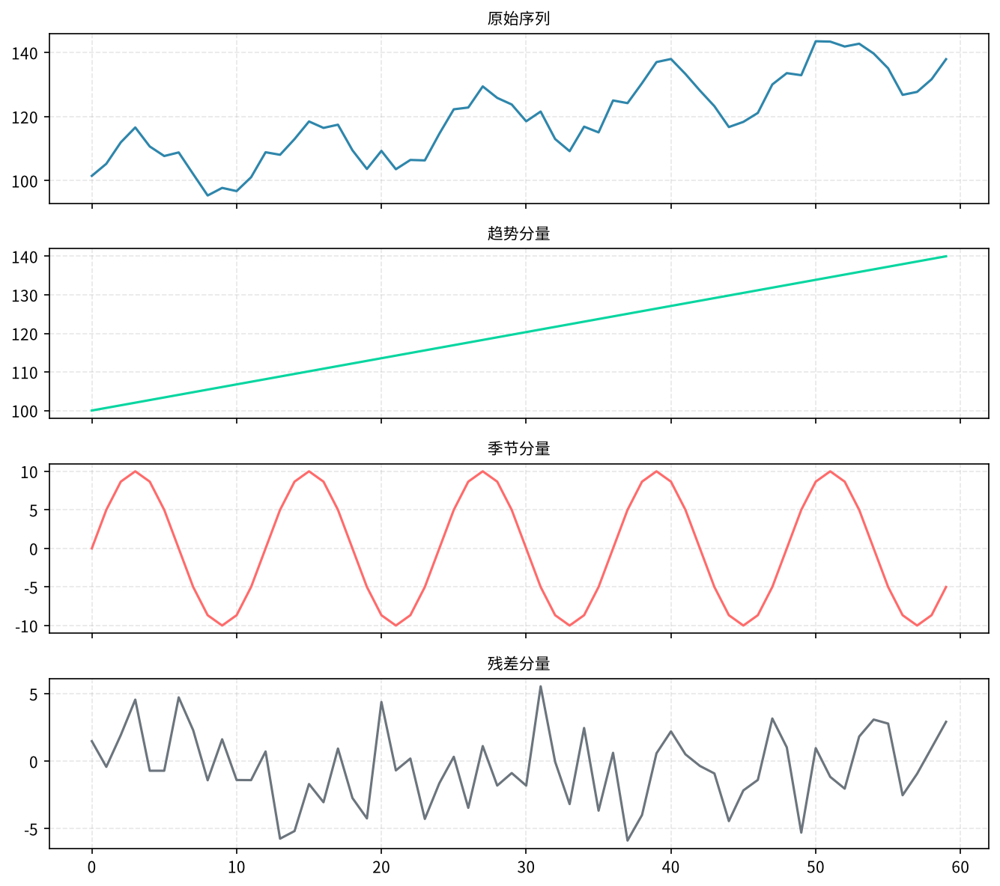
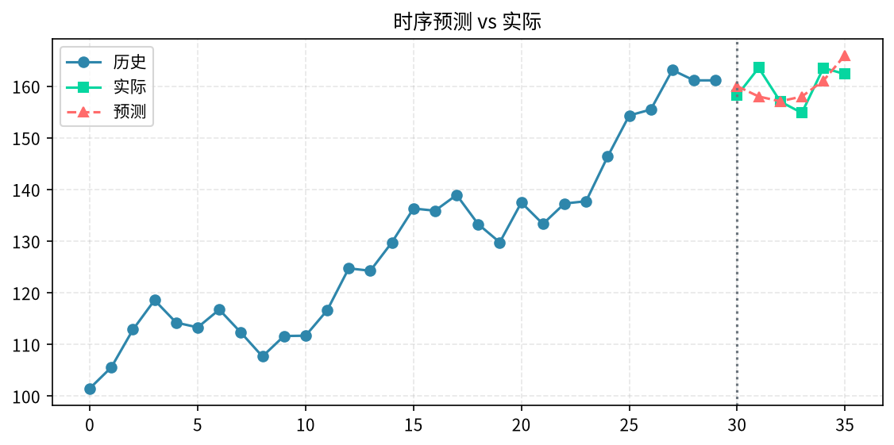

# 第24章 时间序列预测

> 明天的销量是多少？下季度的活跃用户怎么变？服务器流量会不会在晚间高峰打满？时间序列预测是业务预测类需求的核心，也是分析师最容易踩坑的领域——顺序错了，指标全是假的。

---

## 24.1 时间序列 vs 普通回归

### 24.1.1 核心区别

普通回归假设样本之间独立，可以随机打乱。时间序列**不能打乱**——今天的值依赖昨天，下周的值依赖本周，随机划分训练集会"偷看未来"，得到虚高的指标。

| 对比项 | 普通回归 | 时间序列 |
|--------|----------|----------|
| 样本独立性 | 独立 | 时序依赖 |
| 训练/测试划分 | 随机 shuffle | 按时间切分 |
| 特征 | 当前观测 | 滞后值 + 滚动统计 |
| 评估 | 一次 hold-out | 滚动回测 walk-forward |

### 24.1.2 第一条铁律

**永远不要用 `train_test_split(shuffle=True)` 处理时间序列。** 正确做法是按时间切：前 80% 训练，后 20% 测试。

```python
# 错误示例
# X_train, X_test, y_train, y_test = train_test_split(X, y, shuffle=True)

# 正确示例
split = int(len(df) * 0.8)
train = df.iloc[:split]
test = df.iloc[split:]
```

---

## 24.2 时间序列的组成部分

任意一条时间序列都可以拆成四部分：

- **趋势 Trend**：长期向上或向下的方向
- **季节性 Seasonality**：固定周期波动（每天、每周、每年）
- **周期 Cycle**：宏观经济周期（不像季节那么固定）
- **残差 Residual**：剩下的噪声

用 STL 分解可以直接拆开看：

```python
from statsmodels.tsa.seasonal import STL
import matplotlib.pyplot as plt

# ts 是一个以时间为索引的 Series，频率为月度
stl = STL(ts, period=12)  # 月度数据，周期 12
result = stl.fit()
result.plot()
plt.show()
```

看懂分解图能帮你选模型：趋势强用 Holt，季节强用 Holt-Winters 或 SARIMA。



---

## 24.3 移动平均与指数平滑

### 24.3.1 移动平均（MA）

最简单的平滑：用最近 N 期的均值作为下一期预测。

```python
ts.rolling(window=7).mean().plot()
```

缺点是只适合平稳数据，对趋势和季节无能为力。

### 24.3.2 简单指数平滑（SES）

给近期值更高权重，远期值指数衰减：F(t+1) = α·y(t) + (1-α)·F(t)。

### 24.3.3 Holt 线性趋势

在 SES 基础上加一个趋势分量，适合有趋势但无季节的数据。

### 24.3.4 Holt-Winters

最常用的经典方法：趋势 + 季节分量都考虑。月度销售、季度流量基本都能用它起步。

```python
from statsmodels.tsa.holtwinters import ExponentialSmoothing

model = ExponentialSmoothing(
    ts,
    trend='add',           # 加性趋势
    seasonal='add',        # 加性季节
    seasonal_periods=12   # 一年 12 个周期
)
fitted = model.fit()
forecast = fitted.forecast(12)  # 预测未来 12 个月
print(forecast)
```

**要点：** Holt-Winters 是业务预测的"瑞士军刀"——上手快、可解释、对中小数据稳。新模型上来先跑一版它当基线，比任何花哨算法都更有参考价值。

---

## 24.4 ARIMA 与 SARIMA

### 24.4.1 参数含义

ARIMA(p, d, q) 三个参数：

- **p**：自回归项数，用过去多少期的值预测未来
- **d**：差分次数，把非平稳序列变成平稳序列需要差分几次
- **q**：移动平均项数，用过去多少期的误差修正未来

带季节项的叫 SARIMA(p, d, q)(P, D, Q, s)，s 是周期。

### 24.4.2 用 auto_arima 自动找参数

手调 p/d/q 是玄学，用 `pmdarima` 的 auto_arima 让它帮你搜索：

```python
from pmdarima import auto_arima

auto = auto_arima(
    train,
    seasonal=True,        # 有季节
    m=12,                 # 周期 12
    trace=True,
    suppress_warnings=True
)
print(auto.summary())

# 预测
forecast = auto.predict(n_periods=len(test))
```

**注意：** ARIMA 类方法对数据量要求较高（建议至少 2 个完整周期），且对突变、节假日效应处理不好。

---

## 24.5 Prophet

Facebook 开源的 Prophet 是近两年业务预测的主流工具，优点：

- 自动处理**节假日效应**
- 对缺失值鲁棒
- 趋势变点自动检测
- 调参门槛低

```python
from prophet import Prophet

# Prophet 要求 DataFrame 有两列：ds（日期）和 y（值）
df_p = df.rename(columns={'date': 'ds', 'sales': 'y'})

model = Prophet(
    yearly_seasonality=True,
    weekly_seasonality=True,
    seasonality_mode='additive'
)
# 加节假日（比如双十一、春节）
model.add_country_holidays(country_name='CN')
model.fit(df_p)

future = model.make_future_dataframe(periods=90)
forecast = model.predict(future)
model.plot(forecast)
model.plot_components(forecast)
```

**适合场景：** 业务数据、有明显节假日、不需要极致精度、想快速出图出报告。

---

## 24.6 时序特征工程

不管你最终用什么模型（包括 XGBoost），都要先把时间序列"做成表格"。核心是三类特征：

### 24.6.1 滞后特征（Lag）

把过去 N 期的值作为当期特征：

```python
df['lag_1'] = df['sales'].shift(1)   # 昨天
df['lag_7'] = df['sales'].shift(7)   # 上周同日
df['lag_30'] = df['sales'].shift(30) # 上月同日
```

### 24.6.2 滚动统计

过去 7 天/30 天的均值、标准差、最大最小值：

```python
df['roll7_mean'] = df['sales'].shift(1).rolling(7).mean()
df['roll30_std'] = df['sales'].shift(1).rolling(30).std()
```

**关键：** 滚动窗口必须 `shift(1)`——绝对不能用"包含今天"的统计量预测今天，那是未来信息泄露。

### 24.6.3 时间属性特征

月份、星期几、是否月初/月末、是否节假日：

```python
df['month'] = df['date'].dt.month
df['weekday'] = df['date'].dt.weekday
df['is_month_start'] = df['date'].dt.is_month_start.astype(int)
```

### 24.6.4 时序交叉验证

不能用普通 KFold，要用 **TimeSeriesSplit**：

```python
from sklearn.model_selection import TimeSeriesSplit
tscv = TimeSeriesSplit(n_splits=5)
for train_idx, test_idx in tscv.split(X):
    X_tr, X_te = X.iloc[train_idx], X.iloc[test_idx]
    y_tr, y_te = y.iloc[train_idx], y.iloc[test_idx]
    # 训练 + 评估
```

---

## 24.7 用 XGBoost 做时序预测

时序特征做好后，可以直接喂给 XGBoost——这是近几年业务预测的主流做法，效果往往好于传统 ARIMA。

```python
import xgboost as xgb

# 假设 X、y 已经做好滞后特征 + 滚动统计 + 时间属性
split = int(len(df) * 0.8)
X_train, X_test = X.iloc[:split], X.iloc[split:]
y_train, y_test = y.iloc[:split], y.iloc[split:]

model = xgb.XGBRegressor(
    n_estimators=500,
    max_depth=4,
    learning_rate=0.05,
    random_state=42
)
model.fit(
    X_train, y_train,
    eval_set=[(X_test, y_test)],
    early_stopping_rounds=30,
    verbose=False
)

y_pred = model.predict(X_test)
```

**为什么 XGBoost 能做时序：** 滞后特征已经把"时间依赖"显式编码成了表格，模型本身不需要懂时间序列。但它的缺点是**对极端突变、长期趋势漂移不如 Prophet 灵活**，且外推能力有限。

---

## 24.8 评估指标与回测

### 24.8.1 三类常用指标

- **MAE（平均绝对误差）**：直观，单位和原数据一致。
- **RMSE（均方根误差）**：对大误差更敏感。
- **MAPE（平均绝对百分比误差）**：相对误差，方便跨量级比较。

```python
from sklearn.metrics import mean_absolute_error, mean_squared_error
import numpy as np

mae = mean_absolute_error(y_test, y_pred)
rmse = np.sqrt(mean_squared_error(y_test, y_pred))
mape = np.mean(np.abs((y_test - y_pred) / y_test)) * 100
print(f"MAE={mae:.2f}, RMSE={rmse:.2f}, MAPE={mape:.1f}%")
```

### 24.8.2 Walk-forward 回测

时间序列评估不能只切一刀，要做**滚动回测**：

1. 用 2018 年数据训练，预测 2019 年 1 月
2. 窗口往后挪一个月，用 2018~2019.1 数据训练，预测 2019.2
3. 重复 N 次，把所有预测拼起来算指标

这是时序评估的黄金标准，避免"刚好那段好预测"的偶然性。



---

## 24.9 实战：月度销售预测完整流程

```python
import pandas as pd
import numpy as np
import matplotlib.pyplot as plt
from statsmodels.tsa.holtwinters import ExponentialSmoothing
from prophet import Prophet
from sklearn.metrics import mean_absolute_error

# 1. 合成一份月度销售数据（带趋势 + 季节 + 噪声）
np.random.seed(42)
dates = pd.date_range('2018-01-01', '2024-12-31', freq='MS')
n = len(dates)
trend = np.linspace(100, 300, n)
seasonal = 30 * np.sin(2 * np.pi * np.arange(n) / 12)
noise = np.random.normal(0, 10, n)
sales = trend + seasonal + noise
df = pd.DataFrame({'date': dates, 'sales': sales})

# 2. 按时间切训练/测试
split = int(n * 0.8)
train, test = df.iloc[:split], df.iloc[split:]

# 3. 基线 1：Holt-Winters
hw = ExponentialSmoothing(
    train['sales'], trend='add', seasonal='add', seasonal_periods=12
).fit()
hw_pred = hw.forecast(len(test))
hw_mae = mean_absolute_error(test['sales'], hw_pred)

# 4. 基线 2：Prophet
df_p = train.rename(columns={'date': 'ds', 'sales': 'y'})
m = Prophet(yearly_seasonality=True)
m.fit(df_p)
future = m.make_future_dataframe(periods=len(test), freq='MS')
fc = m.predict(future)
prophet_pred = fc['yhat'].iloc[-len(test):].values
prophet_mae = mean_absolute_error(test['sales'], prophet_pred)

# 5. 对比
print(f"Holt-Winters MAE: {hw_mae:.2f}")
print(f"Prophet MAE: {prophet_mae:.2f}")

# 6. 画图
plt.figure(figsize=(12, 5))
plt.plot(df['date'], df['sales'], label='真实值', color='gray')
plt.plot(test['date'], hw_pred, label='Holt-Winters', linestyle='--')
plt.plot(test['date'], prophet_pred, label='Prophet', linestyle=':')
plt.axvline(test['date'].iloc[0], color='red', alpha=0.3)
plt.legend()
plt.title('月度销售预测对比')
plt.show()
```

**业务解读模板：** 选 MAE 更小的模型上线；如果两个差不多，优先选 Prophet（能输出节假日效应、能看到趋势变点）。最后把预测值、置信区间、关键节假日标注成图表给业务方。

---

## 24.10 常见坑

1. **未来信息泄露（最严重）**：滚动统计不 shift、用了未来某天的均值预测过去。每次构造完特征都要问自己："这个值在预测那一刻我真的知道吗？"
2. **时序数据 shuffle 划分**：绝对不要用 `train_test_split(shuffle=True)`。
3. **小样本硬上复杂模型**：一年的数据别跑 1000 棵树的 XGBoost，先用 Holt-Winters 当基线。
4. **忽略节假日效应**：国内业务不加上双十一、春节，预测值会差得离谱。Prophet 的 `add_country_holidays('CN')` 一行解决。
5. **不做回测**：只切一刀的指标不准，一定要 walk-forward 滚动验证。
6. **MAPE 在 y 接近 0 时爆炸**：销售额接近 0 的月份，MAPE 会失真，这时候看 MAE 更靠谱。
7. **趋势漂移**：训练集和测试集之间市场环境变了（疫情、政策），模型会失效。定期重训 + 监控预测残差。

---

## 24.11 本章小结

1. **时序和普通回归的根本区别是"顺序不能乱"**，所有划分、评估都要按时间走。
2. **分解四要素**（趋势/季节/周期/残差）帮你选模型；STL 分解是第一步。
3. **经典三件套**：Holt-Winters（基线）、SARIMA（自动调参）、Prophet（节假日友好）。
4. **XGBoost 做时序**的关键是把滞后特征、滚动统计、时间属性做好，模型本身不用懂时间。
5. **评估**用 MAE/RMSE/MAPE，**回测**用 walk-forward 滚动验证。
6. **头号大坑**是未来信息泄露——滚动窗口记得 shift，划分记得按时间切。

> **下一章**：回到 [第15章 机器学习在数据分析中的应用](15-ml-for-data-analysis.md) 回顾基础，或翻回 [目录](README.md) 查看其他章节。
