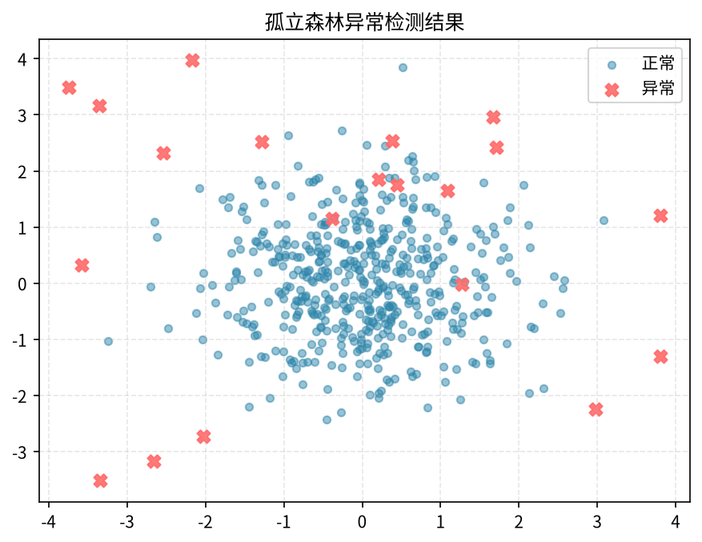

# 第25章 异常检测

> 大部分时候我们关心"正常数据长什么样"，但业务真正爆雷的往往是那 1% 的反常样本。本章讲怎么把它们自动揪出来。

---

## 25.1 什么是异常检测

异常检测（Anomaly Detection）就是找出"和大多数数据点行为不一致"的样本。它和分类的最大区别在于：**异常样本极少，你甚至不知道它们长什么样**——你手里只有一堆"正常"数据，要学会识别"不正常"。

### 常见业务场景

| 场景 | 正常 vs 异常 |
|------|-------------|
| 金融欺诈检测 | 普通消费 vs 盗刷/洗钱 |
| 设备故障监测 | 平稳运行 vs 传感器突刺 |
| 流量监控 | 日常 PV/UV vs 爬虫/DDoS |
| 数据质量 | 合理字段值 vs 录入错误、空值、野点 |
| 风控/登录 | 常用设备地点 vs 异地异地登录 |
| 监控告警 | 正常延迟 vs 接口雪崩 |

为什么不用普通分类？因为欺诈率可能只有 0.1%，你收集到的"异常"标签既少又滞后，还容易过时（欺诈手段一直在变）。

---

## 25.2 异常的三种类型

1. **点异常（Point Anomaly）**：单个样本偏离整体。比如一笔交易 100 万，其余都是几百块。
2. **上下文异常（Contextual Anomaly）**：值本身正常，但在该上下文里不正常。比如 38℃ 的体温正常，但夏天夜里服务器 CPU 38% 却突然为 95%？反过来——凌晨 3 点购物高峰是异常，周末反而正常。**必须结合时间/地点等上下文才判得出来**。
3. **群体异常（Collective Anomaly）**：单个点正常，但一串连起来不正常。比如每秒 1 次的请求持续 1 万秒，单点看不出问题，整体就是爬虫。

实战中先判断你面对的是哪一种，再选方法。

---

## 25.3 统计方法：最朴素也最常用

在数据近似正态分布时，下面这几招足够覆盖 80% 的单变量异常。

### 25.3.1 3-sigma 与 Z-score

```python
import numpy as np

def zscore_outliers(x, threshold=3):
    x = np.asarray(x, dtype=float)
    mu, sigma = x.mean(), x.std(ddof=0)
    z = (x - mu) / sigma
    return x[np.abs(z) > threshold], np.abs(z) > threshold
```

原理：正态分布下 |z|>3 的概率约 0.27%。**坑**：均值和标准差本身会被极端值拉歪（一个亿就能把 sigma 撑爆），导致后面的点全判不出来。

### 25.3.2 MAD（中位数绝对偏差）——抗污染版

```python
def mad_outliers(x, threshold=3.5):
    x = np.asarray(x, dtype=float)
    med = np.median(x)
    mad = np.median(np.abs(x - med)) + 1e-12
    modified_z = 0.6745 * (x - med) / mad   # 修正 MAD 使其可比 sigma
    return np.abs(modified_z) > threshold
```

中位数和 MAD 对极端值不敏感，**适合有长尾的真实业务数据**（金额、时长、流量）。

### 25.3.3 箱线图 IQR

```python
def iqr_outliers(x):
    q1, q3 = np.percentile(x, [25, 75])
    iqr = q3 - q1
    lo, hi = q1 - 1.5*iqr, q3 + 1.5*iqr
    return (x < lo) | (x > hi)
```

EDA 阶段画箱线图就能直接看出来，见 [第04章 EDA](04-exploratory-data-analysis.md)。

> **小结**：单变量、近似对称分布用 3-sigma；长尾/有野点用 MAD；快速探索用 IQR。

---

## 25.4 基于距离与密度：KNN 与 LOF

多变量时，统计方法就不够用了——你不知道"正常"在高维空间长什么样。

### 25.4.1 KNN 距离异常

直觉：离最近邻居都很远的点，就是异常。

```python
from sklearn.neighbors import NearestNeighbors

def knn_scores(X, k=5):
    nn = NearestNeighbors(n_neighbors=k).fit(X)
    dist, _ = nn.kneighbors(X)
    return dist[:, -1]   # 到第 k 个邻居的距离越大越异常
```

### 25.4.2 LOF（Local Outlier Factor）

KNN 看"绝对距离"，LOF 看"局部密度比"。一个点周围本来就稀疏（深山老林），距离大也正常；一个点周围本来很密集（闹市区），突然冒出来一个远邻，才是异常。

```python
from sklearn.neighbors import LocalOutlierFactor

lof = LocalOutlierFactor(n_neighbors=20, contamination=0.05)
y_pred = lof.fit_predict(X)          # +1 正常，-1 异常
score  = -lof.negative_outlier_factor_   # 越大越异常
```

LOF 在"密度不均"的数据上明显比 KNN 好用，但复杂度 O(n²)，百万级样本要采样或换近似算法。

---

## 25.5 隔离森林 Isolation Forest

异常点"少且不同"，所以更容易被随机切分隔离掉。这就是隔离森林的核心直觉。

**原理**：随机选一个特征、随机切一个值，把数据二分。重复直到每个点被单独隔离。异常点因为离群，路径长度天然更短。用大量随机树的平均路径长度打分。

```python
from sklearn.ensemble import IsolationForest

iso = IsolationForest(
    n_estimators=200,
    contamination=0.05,     # 预估异常比例
    random_state=42,
    n_jobs=-1
)
iso.fit(X_train)            # 只喂"正常"数据最佳
labels = iso.predict(X)     # +1 正常 / -1 异常
score  = iso.decision_function(X)   # 越小越异常
```

**优点**：
- 天然处理高维，不需要标准化；
- 对大样本友好（线性复杂度）；
- 不需要标签，无监督。

**缺点**：
- 对"上下文异常"（时序、序列）无能为力；
- `contamination` 是先验，选错会偏；
- 多模态数据（多个密集簇）混在一起时表现一般。



---

## 25.6 One-Class SVM

只看"正常类"长什么样，学一个把正常数据包住的边界，边界外都是异常。

```python
from sklearn.svm import OneClassSVM
from sklearn.preprocessing import StandardScaler

X_scaled = StandardScaler().fit_transform(X_normal)
ocsvm = OneClassSVM(kernel='rbf', gamma='scale', nu=0.05)
ocsvm.fit(X_scaled)
pred = ocsvm.predict(X_test)
```

`nu` 是训练集中允许的异常比例上界。**坑**：必须标准化；核函数 gamma 敏感；样本量大时训练慢（O(n²)），工业界更常用隔离森林代替它。

---

## 25.7 时序异常：滚动统计与 STL 残差

业务监控 90% 是时序。普通统计方法直接用会被"趋势+周期"骗到——周一门店本来就高，你不能说它异常。

### 25.7.1 滚动阈值

```python
import pandas as pd

s = df['pv']
roll_mean = s.rolling(window=28, center=True).mean()   # 4 周均值
roll_std  = s.rolling(window=28, center=True).std()
z = (s - roll_mean) / roll_std
anomaly = z.abs() > 3
```

要点：窗口要覆盖完整周期（日数据用 7/28，小时数据用 24×7）。

### 25.7.2 STL 残差

把时序拆成 趋势 + 季节 + 残差，残差里找异常最干净。

```python
from statsmodels.tsa.seasonal import STL

stl = STL(s, period=24*7, robust=True).fit()
resid = stl.resid
# 对 resid 再用 MAD 打一次分
med = resid.median()
mad = (resid - med).abs().median()
resid_z = 0.6745 * (resid - med) / (mad + 1e-9)
anomaly = resid_z.abs() > 3.5
```

这样周一高峰不再被误报，真出问题时残差才会鼓起来。

---

## 25.8 评估难点：标签稀少怎么办

异常检测是**最难看指标的领域之一**：

- **Precision**：报警里有多少是真异常？（误报率的反面）
- **Recall**：真异常里被抓到多少？（漏报率的反面）
- **F1 / PR-AUC**：因为类别极不平衡，**不要看 ROC-AUC**，PR-AUC 才是真话。

```python
from sklearn.metrics import precision_recall_curve, average_precision_score
ap = average_precision_score(y_true, y_score)   # y_score 越大越像异常
```

**业务成本不对称**：
- 漏报一笔欺诈 = 直接赔钱；
- 误报一笔 = 客服打个电话核实。
所以欺诈场景倾向**高召回**（宁错杀不放过）；内部监控告警倾向**高精确**（别半夜把人叫起来）。

阈值不要拍脑袋。画 PR 曲线，按"每报警 N 次里我能接受误报几次"反推阈值。

---

## 25.9 实战：合成信用卡欺诈数据 + 隔离森林

下面这段可以直接跑。我们用 `make_blobs` 造一大团"正常交易"，再撒一小撮"欺诈点"，看隔离森林能不能把它们抓出来。

```python
import numpy as np
import matplotlib.pyplot as plt
from sklearn.datasets import make_blobs
from sklearn.ensemble import IsolationForest
from sklearn.metrics import classification_report, confusion_matrix

# 1. 造数据：1000 个正常点（两个簇）+ 40 个野点
rng = np.random.RandomState(42)
X_normal, _ = make_blobs(n_samples=1000, centers=[[0, 0], [5, 5]],
                         cluster_std=0.8, random_state=42)
X_outlier   = rng.uniform(low=-6, high=10, size=(40, 2))
X = np.vstack([X_normal, X_outlier])
y_true = np.array([1]*1000 + [-1]*40)   # 1=正常, -1=异常（sklearn 约定）

# 2. 训练隔离森林（假设我们不知道标签，只知道正常占比约 96%）
model = IsolationForest(n_estimators=200, contamination=40/1040,
                        random_state=42)
model.fit(X)
y_pred = model.predict(X)

# 3. 评估
print(confusion_matrix(y_true == -1, y_pred == -1))
print(classification_report(y_true == -1, y_pred == -1, digits=3))

# 4. 可视化
xx, yy = np.meshgrid(np.linspace(X[:,0].min()-1, X[:,0].max()+1, 200),
                     np.linspace(X[:,1].min()-1, X[:,1].max()+1))
Z = model.decision_function(np.c_[xx.ravel(), yy.ravel()]).reshape(xx.shape)
plt.contourf(xx, yy, Z, cmap=plt.cm.Blues_r, alpha=0.5)
plt.scatter(X_normal[:,0], X_normal[:,1], s=6, label='normal')
plt.scatter(X_outlier[:,0], X_outlier[:,1], s=20, c='red', marker='x', label='fraud')
plt.legend(); plt.title('Isolation Forest'); plt.show()
```

预期：红色 × 几乎全被圈出，正常簇内部基本不误报。把这段代码拿去跑真实业务数据时，替换 `X` 为你自己的特征矩阵即可。

---

## 25.10 常见坑

1. **训练集里混进了异常**。隔离森林/LOF 会把异常"学成正常"，之后永远发现不了同类问题。上线前先用 MAD/IQR 粗筛一遍训练数据。
2. **阈值一刀切**。不同业务线、不同时间段分布不一样，阈值要分群、分时段。
3. **概念漂移**。用户行为、欺诈手法都会变。模型要定期重训，监控**报警率**——报警率连续一周飘移就是信号。
4. **特征尺度差太大**。One-Class SVM / LOF / KNN 对尺度敏感，记得 `StandardScaler`；隔离森林则不用。
5. **直接看 ROC-AUC**。极端不平衡下 ROC 看着 0.99，PR-AUC 可能只有 0.1。
6. **把"新趋势"当异常**。大促首日流量翻倍是业务预期，不是 bug——异常检测要和业务日历对齐。

---

## 25.11 本章小结

- 异常检测三类型：**点 / 上下文 / 群体**，先分类再选方法。
- 单变量用 **MAD / IQR**，多变量用 **隔离森林**（首选）或 LOF。
- 时序先 **STL 拆趋势季节**，再在残差上打异常分。
- 评估看 **PR-AUC**，阈值由业务成本（漏报 vs 误报）反推。
- 无监督为主，标签靠事后回流，模型要随业务漂移持续重训。

> **下一章**：[第26章 NLP 在数据分析中的应用](26-nlp-for-analytics.md) — 评论情感、工单分类、关键词提取，把文本变成可分析的数字。
