# 第32章 Python绘图全教程

> 用 matplotlib + seaborn 画出专业级图表。从基础概念到8种常用图表、子图布局、配色规范和反例避坑。

---

## 32.1 Matplotlib 基础概念

很多初学者上来就写 `plt.plot()`，画出来的图丑、标题乱、坐标轴挤成一团，根本原因是没理解 Matplotlib 的三层结构。Matplotlib 是 Python 生态里最基础、最强大的绘图库，几乎所有其他可视化库（包括 Seaborn、Pandas 自带绘图、Plotly 的部分后端）都是建立在它之上的。把 Matplotlib 的概念搞清楚，后面学任何高级库都会事半功倍。

**Figure vs Axes**：

- **Figure（画布）**：整张图的最外层容器，可以理解为一张白纸。一个 Figure 可以包含多个 Axes，相当于在一张白纸上贴好几张小坐标纸。
- **Axes（坐标系）**：画在白纸上的一个独立坐标系，是真正画图的地方。不要把 Axes 理解成"轴"，它其实是"一个子图"，里面同时包含 X 轴、Y 轴、图例、标题等。
- **元素（Artist）**：Axes 内部的线、点、柱子、标签、刻度、箭头等所有可见对象。

很多人画多图时把 `plt` 和 `ax` 混用，结果发现图被覆盖了，就是因为没分清这两层。记住一句话：**Figure 管整张图的大小和保存，Axes 管具体在哪个坐标系里画什么**。

```python
import matplotlib.pyplot as plt

# 标准写法：创建 8x4 英寸的画布，并返回一个 Axes 对象
fig, ax = plt.subplots(figsize=(8, 4), dpi=120)

# 所有画图操作都挂在 ax 上，而不是 plt
ax.plot([1, 2, 3, 4], [1, 4, 2, 3])
ax.set_title("示例")
ax.set_xlabel("x")
ax.set_ylabel("y")

plt.tight_layout()
plt.savefig("demo.png", dpi=150)
plt.show()
```

`fig, ax = plt.subplots()` 是 90% 场景下的最优写法：它一次性帮你建好画布和坐标系，后续全部通过 `ax.xxx` 操作，避免 `plt` 全局状态带来的混乱。`figsize` 的单位是英寸，`dpi` 是每英寸点数，两者相乘就是图片的像素分辨率。比如 `figsize=(8, 4), dpi=120` 就是一张 960×480 的图。

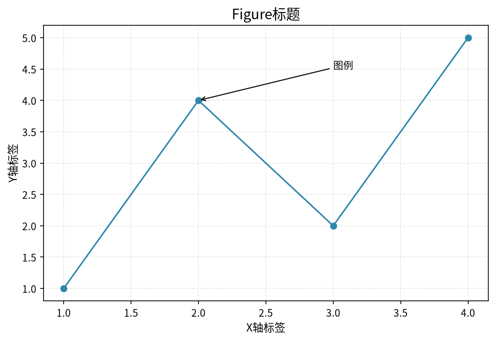

**要点**：Figure 是画布，Axes 是坐标系；一张图至少有一个 Figure 和一个 Axes；养成 `ax.xxx` 面向对象的写法习惯；不要混用 `plt` 和 `ax`。

---

## 32.2 折线图：基础用法

折线图用来展示**随连续变量（通常是时间）变化的趋势**，是最常用也最容易被滥用的图表。核心函数是 `ax.plot()`。折线图之所以适合趋势，是因为人眼对"连线的斜率"非常敏感，能一眼看出上升、下降、拐点和周期。

```python
import numpy as np
import matplotlib.pyplot as plt

x = np.linspace(0, 2 * np.pi, 200)
y = np.sin(x)

fig, ax = plt.subplots(figsize=(8, 4), dpi=120)
ax.plot(x, y,
        color="#2E86AB",     # 线条颜色
        linewidth=2,         # 线条粗细
        linestyle="-",       # 线型：- 实线, -- 虚线, -. 点划线
        marker=None)         # 数据点标记：o 圆点, s 方块, ^ 三角

ax.set_title("正弦曲线")
ax.set_xlabel("x (弧度)")
ax.set_ylabel("sin(x)")
ax.grid(True, alpha=0.3)

plt.tight_layout()
plt.savefig("line_basic.png", dpi=150)
plt.show()
```

画折线图时要注意三个细节：第一，`linewidth` 建议 1.5 到 2.5，太细看不清、太粗显笨重；第二，`marker` 只在数据点稀疏时加，点密集时加 marker 会变成一团黑；第三，`grid` 要加 `alpha` 让网格变浅，否则网格会抢走主线的注意力。

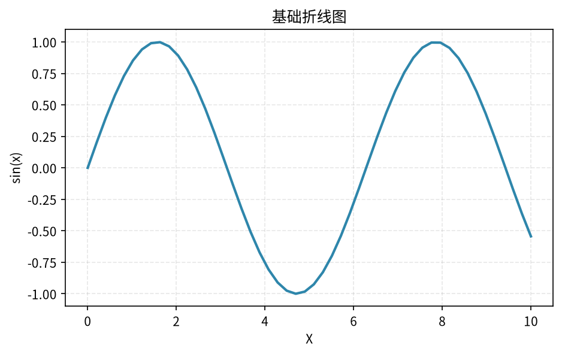

**要点**：折线图适合趋势；线条粗细控制在 2 左右；marker 按需添加；网格务必浅淡。

---

## 32.3 多系列折线图

同一个 Axes 里画多条线，只要多次调用 `ax.plot()` 即可。当你想对比几条随时间变化的曲线时（比如不同产品的月销、不同城市的气温），多系列折线是首选。但要注意：线一旦超过 5 条，图就会变成意大利面，这时应该考虑分面或者只保留最重要的几条。

```python
x = np.linspace(0, 2 * np.pi, 200)

fig, ax = plt.subplots(figsize=(8, 4), dpi=120)
ax.plot(x, np.sin(x),  label="sin(x)",  color="#2E86AB", linewidth=2)
ax.plot(x, np.cos(x),  label="cos(x)",  color="#FF6B6B", linewidth=2)
ax.plot(x, np.sin(x)**2, label="sin²(x)", color="#06D6A0", linewidth=2, linestyle="--")

ax.set_title("多函数对比")
ax.set_xlabel("x")
ax.legend(loc="upper right")   # 图例位置
ax.grid(True, alpha=0.3)

plt.tight_layout()
plt.savefig("line_multi.png", dpi=150)
plt.show()
```

图例的位置可以用 `loc` 自动选择，常用的有 `upper right`、`upper left`、`lower right`、`best`。`best` 会自动挑一块和线重叠最少的位置，但有时算得慢。如果某条线想突出，可以让其他线用浅灰或虚线。

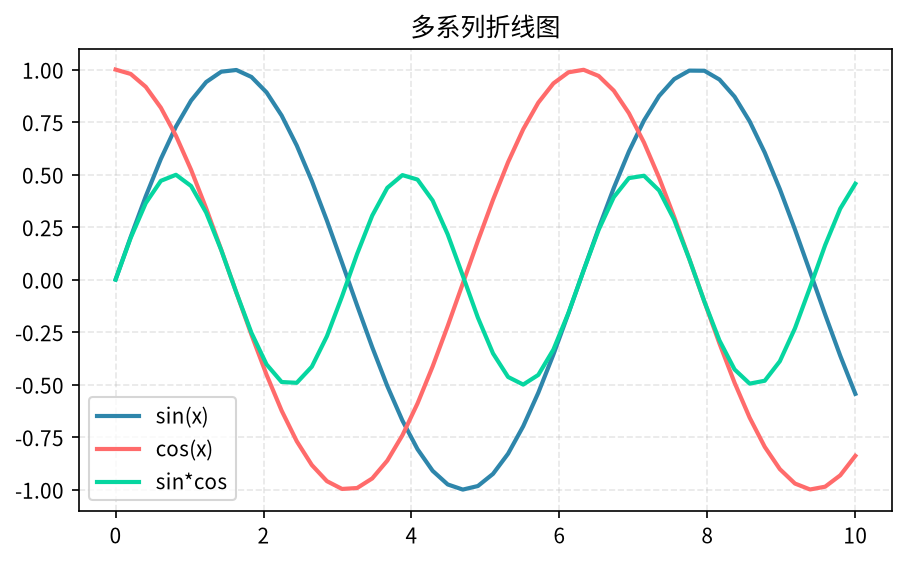

**要点**：每条线都要写 `label`；图例位置用 `loc` 控制；超过 5 条线时考虑分面或筛选。

---

## 32.4 带标注的折线图

`ax.annotate()` 用来在图上指出关键数据点，配合箭头说明。一张图如果没有任何解释，读者只能自己猜；标注一两个极值、拐点、异常点，整图的信息密度立刻上去。

```python
x = np.linspace(0, 2 * np.pi, 200)
y = np.sin(x)

fig, ax = plt.subplots(figsize=(8, 4), dpi=120)
ax.plot(x, y, color="#2E86AB", linewidth=2)

# 标注最大值
peak_x = np.pi / 2
peak_y = 1
ax.annotate(f"最大值 ({peak_x:.2f}, {peak_y:.2f})",
            xy=(peak_x, peak_y),              # 箭头指向的点
            xytext=(peak_x + 0.5, 0.8),       # 文字位置
            arrowprops=dict(arrowstyle="->", color="#333"),
            fontsize=10)

ax.set_title("带标注的折线图")
ax.grid(True, alpha=0.3)
plt.tight_layout()
plt.savefig("line_annotate.png", dpi=150)
plt.show()
```

`xy` 是箭头指向的目标数据点，`xytext` 是文字摆放的位置，两者都用数据坐标系。`arrowprops` 里 `arrowstyle="->"` 是最干净的箭头样式，不要用默认的那种丑箭头。标注的文字要短，把坐标写进去是个好习惯，方便读者回查数据。

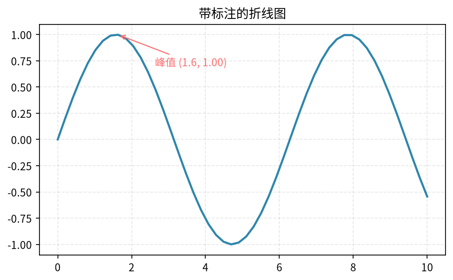

**要点**：`xy` 指向数据，`xytext` 放文字；箭头用 `arrowprops`；一张图最多标注 2–3 个关键点，否则乱成一锅粥。

---

## 32.5 柱状图：基础用法

柱状图用来**对比不同类别之间的数值大小**，是最常用的图表之一，也是最容易被滥用的图表之一。核心函数 `ax.bar()`。柱状图之所以直观，是因为人眼比较长度比比较角度（饼图）或比较面积（气泡图）要准确得多。

```python
cats = ["A", "B", "C", "D", "E"]
vals = [23, 45, 17, 38, 29]

fig, ax = plt.subplots(figsize=(8, 4), dpi=120)
bars = ax.bar(cats, vals,
              color="#2E86AB",
              edgecolor="white",
              linewidth=1.2)

# 在柱子顶部标数值
for b, v in zip(bars, vals):
    ax.text(b.get_x() + b.get_width()/2, v + 1, str(v),
            ha="center", va="bottom", fontsize=9)

ax.set_title("类别数值对比")
ax.set_ylabel("数量")
ax.set_ylim(0, max(vals) * 1.15)

plt.tight_layout()
plt.savefig("bar_basic.png", dpi=150)
plt.show()
```

在柱子顶部标数值是个非常实用的技巧：读者不必费劲去对照 Y 轴刻度，直接读数字就能拿到精确值。`ax.text` 的 `ha="center"` 是水平居中，`va="bottom"` 是让文字底边对齐给定的 y 坐标。`edgecolor="white"` 给柱子加一道白边，相邻柱子不会糊在一起。

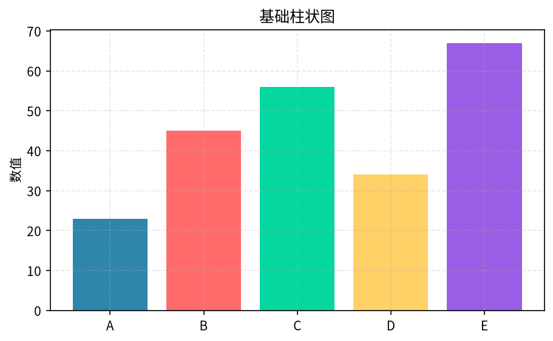

**要点**：Y 轴必须从 0 开始；柱子之间留白 0.2–0.3；数值直接标在柱子上比依赖图例更清晰。

---

## 32.6 堆叠柱状图

堆叠柱状图在同一根柱子里分层，展示"总量 + 构成"。比如季度销售额按线上、App、线下三个渠道堆叠，既能看到每季度的总量，又能看到各渠道的占比变化。关键是 `bottom` 参数。

```python
cats = ["Q1", "Q2", "Q3", "Q4"]
web = [120, 150, 180, 210]
app = [80, 110, 130, 160]
offline = [50, 60, 75, 90]

fig, ax = plt.subplots(figsize=(8, 4), dpi=120)
ax.bar(cats, web,     label="线上",   color="#2E86AB")
ax.bar(cats, app,     bottom=web,    label="App",   color="#FF6B6B")
ax.bar(cats, offline, bottom=np.array(web)+np.array(app),
       label="线下", color="#06D6A0")

ax.set_title("季度销售额按渠道堆叠")
ax.set_ylabel("销售额（万元）")
ax.legend()

plt.tight_layout()
plt.savefig("bar_stacked.png", dpi=150)
plt.show()
```

堆叠的逻辑是：第一层画在底部，第二层用 `bottom=第一层` 摞在第一层上面，第三层用 `bottom=第一层+第二层` 摞在最上面。注意后面的 `bottom` 要写成 `np.array` 相加，否则 Python 列表会变成字符串拼接，这是新手最常见的 bug。堆叠最多 3–4 层，层数再多就看不清了。

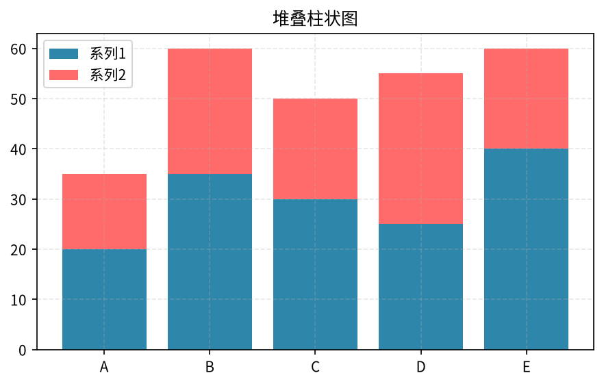

**要点**：下一层用 `bottom=上一层累加值`；用 `np.array` 做加法；堆叠最多 3–4 层；要对比"层内差异"就用分组柱状，而不是堆叠。

---

## 32.7 横向条形图

当类别名很长时，横向条形图（`barh`）比竖向柱状图更易读。比如你要列十个编程语言的流行度，竖向柱状图的 X 轴标签会被挤得竖起来或者重叠；横向条形图把类别名放在 Y 轴上，空间绰绰有余。

```python
langs = ["Python", "JavaScript", "Java", "C++", "Go", "Rust", "TypeScript"]
popularity = [95, 90, 85, 78, 65, 45, 70]

# 排序，让最高的在最上面
order = np.argsort(popularity)
langs = [langs[i] for i in order]
popularity = [popularity[i] for i in order]

fig, ax = plt.subplots(figsize=(8, 4), dpi=120)
ax.barh(langs, popularity, color="#2E86AB")
ax.set_title("语言流行度评分")
ax.set_xlabel("评分")

plt.tight_layout()
plt.savefig("bar_horizontal.png", dpi=150)
plt.show()
```

`barh` 和 `bar` 的区别只是方向换了，但排序的直觉也跟着变：`barh` 画出来最下面是第一个元素，所以我们用 `argsort` 把小的放前面，这样最大的会自然落在最上面，符合"排行榜从上往下读"的习惯。

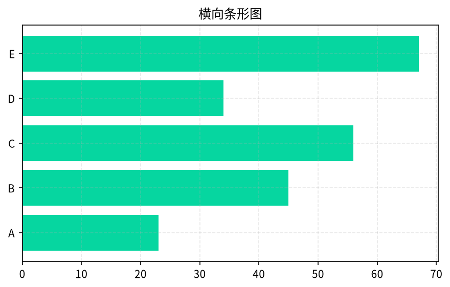

**要点**：类别名长、类别数量 ≥5 时优先用横向；一定按数值排序，让眼睛更容易比较。

---

## 32.8 散点图

散点图用来**观察两个连续变量之间的关系**。比如身高和体重、广告投入和销售额、学习时长和考试分数，散点图能让你一眼看出正相关、负相关还是无关，还能看到离群点。

```python
np.random.seed(0)
x = np.random.randn(200)
y = 2 * x + np.random.randn(200) * 0.5

fig, ax = plt.subplots(figsize=(8, 4), dpi=120)
ax.scatter(x, y,
           s=30,                  # 点的大小
           c="#2E86AB",
           alpha=0.6,             # 透明度，重叠点关键
           edgecolors="none")

ax.set_title("x 与 y 的关系")
ax.set_xlabel("x")
ax.set_ylabel("y")
ax.grid(True, alpha=0.3)

plt.tight_layout()
plt.savefig("scatter_basic.png", dpi=150)
plt.show()
```

散点图最关键的参数是 `alpha`。当点数成百上千时，点会重叠在一起，看起来就是一坨颜色。给 `alpha=0.5` 左右，重叠的地方颜色自然加深，反而能看出数据密度。`edgecolors="none"` 关掉默认的黑边，否则每个点都像带圈的大头针，视觉很脏。

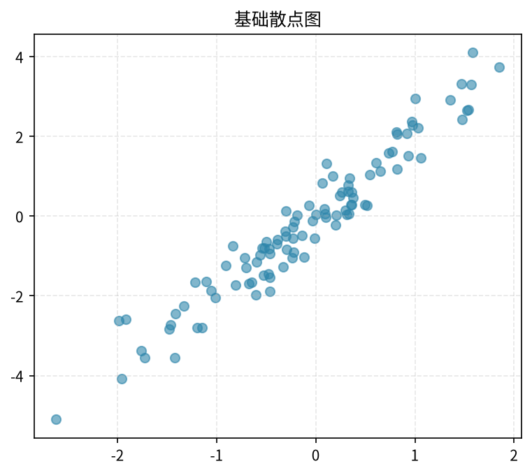

**要点**：点数大于 500 时一定要加 `alpha`；点不要太大，`s=20–50` 通常刚好；关掉默认的黑边。

---

## 32.9 气泡图

在散点基础上，用点的**大小**和**颜色**编码第三、第四个维度，并配 `colorbar`。气泡图适合展示"两个主坐标 + 两个附加维度"的场景，比如城市人口分布：X 是经度、Y 是纬度、点大小是人口、颜色是 GDP。

```python
np.random.seed(1)
x = np.random.rand(50)
y = np.random.rand(50)
size = np.random.rand(50) * 500 + 30     # 气泡大小
color = np.random.rand(50)               # 颜色值

fig, ax = plt.subplots(figsize=(8, 4), dpi=120)
sc = ax.scatter(x, y, s=size, c=color, cmap="viridis", alpha=0.7)
fig.colorbar(sc, ax=ax, label="颜色值")   # 必须加 colorbar

ax.set_title("气泡图：x、y、大小、颜色四维")
plt.tight_layout()
plt.savefig("scatter_bubble.png", dpi=150)
plt.show()
```

气泡图最大的坑是大小编码：人眼对面积的感知是线性的，但 `s` 参数对应的是点的**面积**而不是半径，所以只要你直接把数值传给 `s`，比例就是对的。如果你先开平方再乘倍数，反而会扭曲。另外，`colorbar` 是必须的，否则读者不知道颜色深浅代表什么。

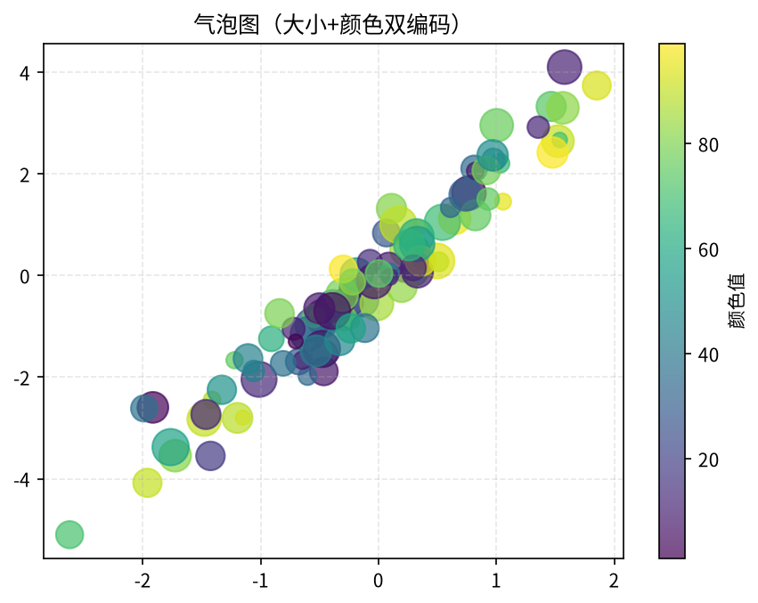

**要点**：大小编码容易被误读，气泡面积（不是半径）应与数值成正比；务必配 `colorbar` 说明颜色含义。

---

## 32.10 直方图

直方图用来**看单个连续变量的分布**。它把数值切成若干区间（bins），数每个区间里有多少个样本，画成相邻的柱子。直方图能告诉你数据是正态的、偏态的、双峰的还是长尾的，这是后续建模选什么统计方法的基础。

```python
np.random.seed(2)
data = np.random.randn(1000) * 10 + 50

fig, ax = plt.subplots(figsize=(8, 4), dpi=120)
ax.hist(data, bins=30, color="#2E86AB", edgecolor="white", alpha=0.85)
ax.set_title("样本分布直方图（均值≈50）")
ax.set_xlabel("数值")
ax.set_ylabel("频数")

plt.tight_layout()
plt.savefig("histogram_basic.png", dpi=150)
plt.show()
```

`bins` 的选择直接影响你看到的分布形状：bins 太少会把细节糊掉，太多会冒出很多锯齿。经验法则是 `bins=20` 起步，样本量上千可以加到 50。直方图和柱状图长得像，但本质不同：直方图的柱子必须相邻，因为它表示"连续区间"；柱状图的柱子是离散类别，必须留白。

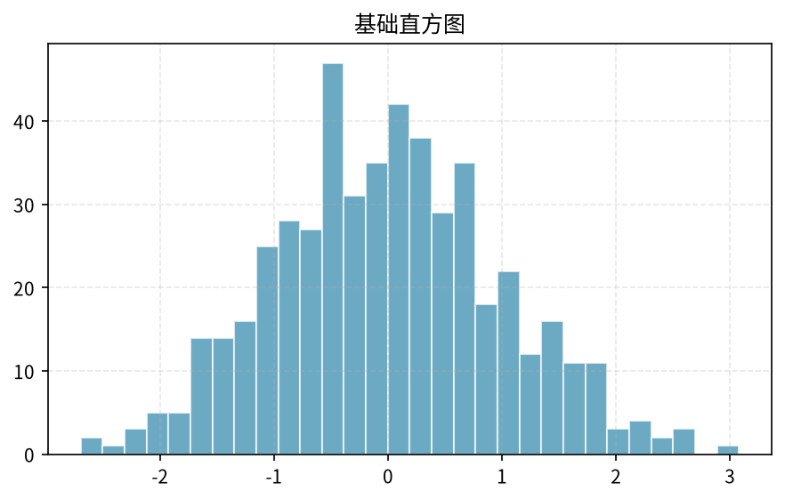

**要点**：`bins` 建议 20–50；直方图柱子必须相邻（不要留白），它表示"区间"而不是"类别"；配合 `edgecolor="white"` 让每个区间分界清晰。

---

## 32.11 箱线图

箱线图用**四分位数**概括分布，能一眼看出离群点。相比直方图，箱线图更紧凑，适合把多组数据并排比较。一个箱体装了 50% 的数据，中间那条线是中位数，两侧的须延伸到 1.5 倍四分位距内的极值，再外面的点就是离群值。

```python
np.random.seed(3)
data = [np.random.randn(100) * (i+1) for i in range(4)]

fig, ax = plt.subplots(figsize=(8, 4), dpi=120)
bp = ax.boxplot(data,
                patch_artist=True,           # 允许填色
                labels=["组1", "组2", "组3", "组4"])

colors = ["#2E86AB", "#FF6B6B", "#06D6A0", "#FFD166"]
for patch, c in zip(bp["boxes"], colors):
    patch.set_facecolor(c)
    patch.set_alpha(0.8)

ax.set_title("四组数据箱线图")
plt.tight_layout()
plt.savefig("boxplot_basic.png", dpi=150)
plt.show()
```

`patch_artist=True` 是个关键开关：默认情况下箱体是空心的线框，打开这个参数后才能用 `set_facecolor` 填色。给每个箱体填不同的颜色，比全是黑线框的箱线图好看得多，读者也更容易分辨组别。

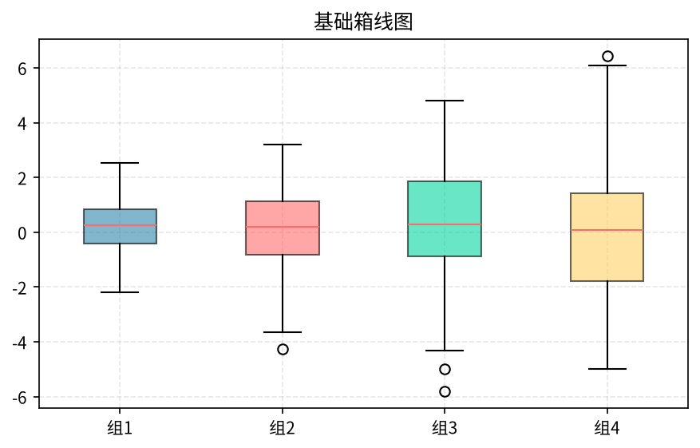

**要点**：箱体 = 25%–75% 分位数，中线 = 中位数，须 = 1.5×IQR 内的极值，点 = 离群值；`patch_artist=True` 才能填色。

---

## 32.12 热力图

热力图用颜色深浅表示**矩阵数值**，适合展示相关系数、混淆矩阵、用户行为矩阵。它一眼能看出"哪几行/列之间强相关"，是探索性分析的标配。

```python
np.random.seed(4)
corr = np.random.rand(5, 5)
corr = (corr + corr.T) / 2
np.fill_diagonal(corr, 1)

fig, ax = plt.subplots(figsize=(7, 5), dpi=120)
im = ax.imshow(corr, cmap="RdBu_r", vmin=-1, vmax=1)

ax.set_xticks(range(5))
ax.set_yticks(range(5))
ax.set_xticklabels(["A", "B", "C", "D", "E"])
ax.set_yticklabels(["A", "B", "C", "D", "E"])
fig.colorbar(im, ax=ax)

ax.set_title("相关系数矩阵")
plt.tight_layout()
plt.savefig("heatmap_basic.png", dpi=150)
plt.show()
```

配色选择很关键：如果数据是发散的（比如相关系数在 -1 到 1 之间），要用 `RdBu_r` 这种发散色，让 0 落在白色中间、正红负蓝（或反过来）。如果数据是顺序型的（比如销售额、温度），用 `viridis` 这种顺序色。`vmin` 和 `vmax` 手动固定范围，能让不同热力图之间可比。

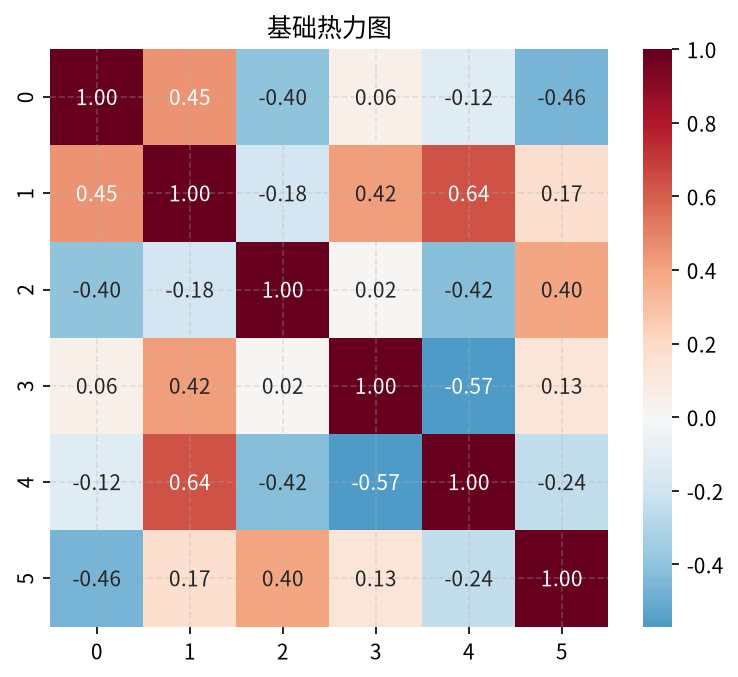

**要点**：发散型数据（如相关系数）用 `RdBu_r` 这类发散色，0 在中间；顺序型数据用 `viridis`；手动设 `vmin`/`vmax` 让不同图可比。

---

## 32.13 子图布局

`plt.subplots(2, 2)` 一次创建 2×2 的子图网格。当你要把多个相关的图放在一起对比时（比如四个城市的气温曲线），子图布局比单独画四张图更有整体感。

```python
fig, axes = plt.subplots(2, 2, figsize=(10, 7), dpi=120)

x = np.linspace(0, 2*np.pi, 100)
axes[0, 0].plot(x, np.sin(x),  color="#2E86AB")
axes[0, 0].set_title("sin")
axes[0, 1].plot(x, np.cos(x),  color="#FF6B6B")
axes[0, 1].set_title("cos")
axes[1, 0].plot(x, np.tan(x),  color="#06D6A0")
axes[1, 0].set_title("tan")
axes[1, 1].plot(x, np.exp(x/3), color="#FFD166")
axes[1, 1].set_title("exp")

plt.tight_layout()
plt.savefig("subplot_layout.png", dpi=150)
plt.show()
```

返回的 `axes` 是二维数组，`axes[i, j]` 对应第 i 行第 j 列。如果只画一行或一列，`axes` 会变成一维数组，不要强行加第二个下标。`plt.tight_layout()` 是必须的，它会自动调整子图间距，避免标题和坐标轴文字重叠。

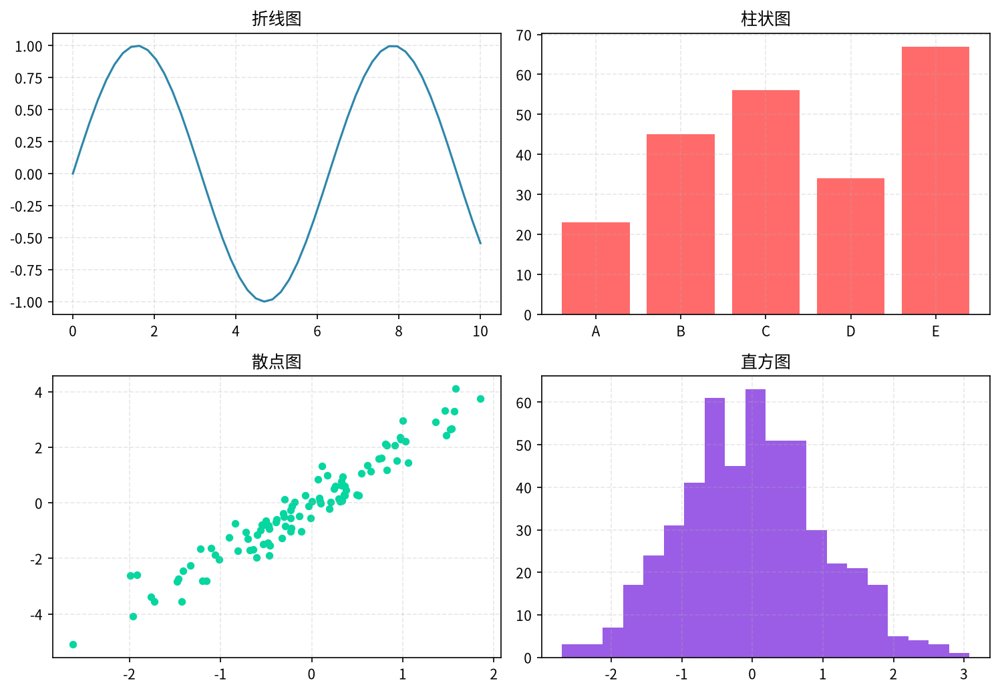

**要点**：`axes` 是二维数组；`plt.tight_layout()` 是必须的；共享坐标轴可以加 `sharex=True` 或 `sharey=True`，让子图之间更可比。

---

## 32.14 Seaborn 散点图

Seaborn 是建立在 Matplotlib 之上的高级封装，画带类别分组的图更省事。Matplotlib 画分组图要自己循环、自己拼图例，Seaborn 用 `hue` 参数一行搞定。

```python
import seaborn as sns
sns.set_theme(style="whitegrid")

tips = sns.load_dataset("tips")   # 内置示例数据集

fig, ax = plt.subplots(figsize=(8, 5), dpi=120)
sns.scatterplot(data=tips, x="total_bill", y="tip",
                hue="time",       # 按 time 类别着色
                style="time",
                s=60, alpha=0.8, ax=ax)
ax.set_title("账单金额 vs 小费（按午/晚餐分组）")
plt.tight_layout()
plt.savefig("seaborn_scatter.png", dpi=150)
plt.show()
```

Seaborn 的最大优势是直接吃 DataFrame：你只要传 `data=tips`，然后用列名引用 `x="total_bill"`、`hue="time"`，它会自动处理分组、配色、图例。`hue` 是按类别着色，`style` 是按类别改变点的形状（圆、三角、方块），两者配合可以在黑白打印时也能区分组别。

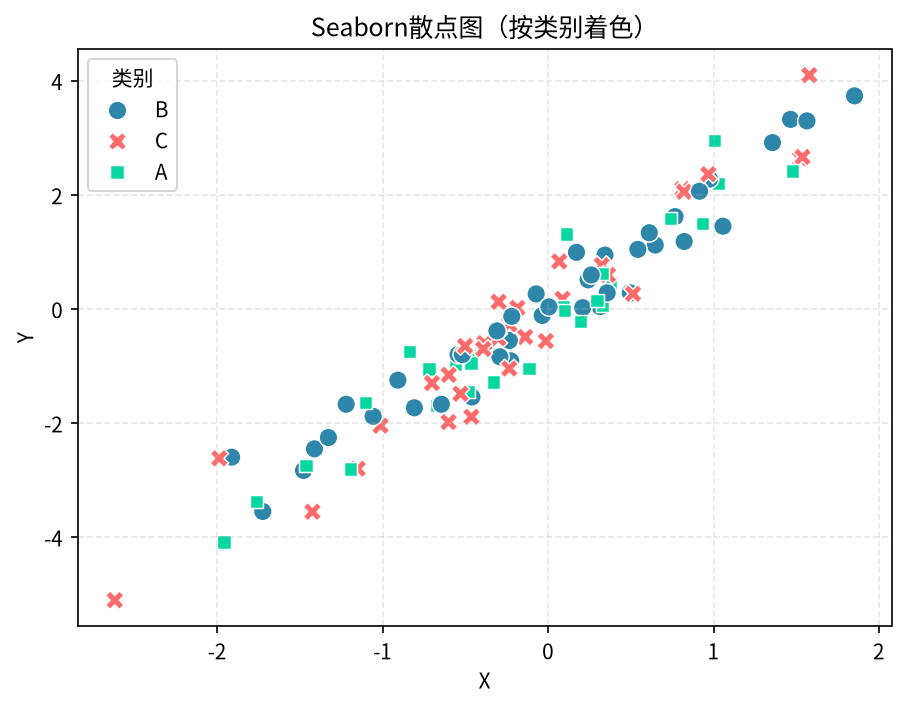

**要点**：`hue` 是 Seaborn 最强大的参数之一；数据直接用 DataFrame 传入，用列名引用，不用手写数组；`style` 配合 `hue` 在黑白场景下救命。

---

## 32.15 Seaborn 箱线图

```python
fig, ax = plt.subplots(figsize=(8, 5), dpi=120)
sns.boxplot(data=tips, x="day", y="total_bill",
            hue="smoker", palette="Set2", ax=ax)
ax.set_title("不同日期的账单分布（按是否吸烟分组）")
plt.tight_layout()
plt.savefig("seaborn_box.png", dpi=150)
plt.show()
```

Seaborn 的箱线图比 Matplotlib 原生的好看很多：它默认带漂亮的配色、醒目的离群点标记、合理的间距。`palette="Set2"` 是 Seaborn 自带的一组柔和配色，比你自己手挑颜色协调得多。

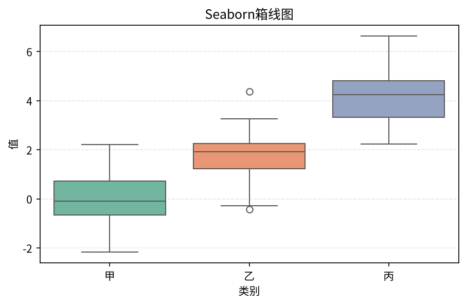

**要点**：`hue` 配合箱线图自动生成分组箱线，比 Matplotlib 手算 `bottom` 简单得多；`palette` 用 Seaborn 内置配色更协调。

---

## 32.16 Seaborn 热力图

```python
corr = tips.corr(numeric_only=True)

fig, ax = plt.subplots(figsize=(6, 5), dpi=120)
sns.heatmap(corr, annot=True, fmt=".2f",
            cmap="RdBu_r", center=0, ax=ax)
ax.set_title("tips 数据集相关系数")
plt.tight_layout()
plt.savefig("seaborn_heatmap.png", dpi=150)
plt.show()
```

`annot=True` 直接在每个格子里写数值，`fmt=".2f"` 控制保留两位小数。`center=0` 让发散色对称，也就是 0 对应中间色（白色），正相关偏红、负相关偏蓝。这一套下来，相关系数矩阵不用导出 Excel 就能直接看懂。

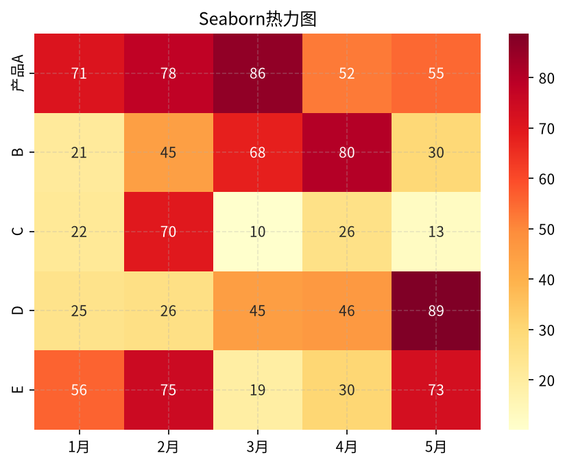

**要点**：`annot=True` 显示数值，`fmt=".2f"` 控制精度；`center=0` 让发散色对称；Seaborn 热力图比原生 `imshow` 少写十行配置代码。

---

## 32.17 统一风格模板

在项目开头设置一次 `plt.rcParams`，整套图风格就统一了。很多人画出来的图"每张都好看但拼在一起不像是一套"，就是因为每张图都在临时调字体、调颜色。下面是可复用的模板：

```python
import matplotlib.pyplot as plt
import matplotlib as mpl

# ===== 统一风格模板 =====
mpl.rcParams.update({
    # 字体（中文用系统已有字体，下面是常见配置）
    "font.family": ["DejaVu Sans", "PingFang SC", "Microsoft YaHei", "SimHei"],
    "axes.unicode_minus": False,           # 负号正常显示

    # 画布与分辨率
    "figure.dpi": 120,
    "savefig.dpi": 200,
    "savefig.bbox": "tight",

    # 配色
    "axes.prop_cycle": plt.cycler(
        color=["#2E86AB", "#FF6B6B", "#06D6A0", "#FFD166", "#9B5DE5", "#F15BB5"]
    ),

    # 网格
    "axes.grid": True,
    "grid.alpha": 0.3,
    "grid.linestyle": "--",

    # 坐标轴与字体
    "axes.titlesize": 13,
    "axes.labelsize": 11,
    "xtick.labelsize": 9,
    "ytick.labelsize": 9,
    "legend.fontsize": 9,
})

# 推荐四色：#2E86AB（蓝）、#FF6B6B（红）、#06D6A0（绿）、#FFD166（黄）
```

把这段代码放在项目工具函数文件里，所有图都 `import` 它，出来的图就能保持统一专业风格。`axes.unicode_minus=False` 这一行非常重要，否则负号会显示成方块，中文画图时经常踩这个坑。`savefig.bbox="tight"` 让保存时自动裁掉多余白边。

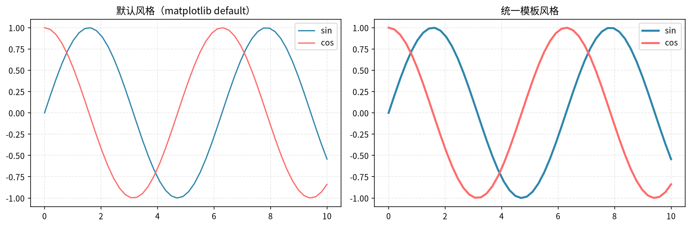

**要点**：字体、DPI、配色、网格在一个地方统一设置；不要每张图手动调；中文环境务必加 `axes.unicode_minus=False`。

---

## 32.18 绘图避坑：反例警示

### 反例一：不要用 3D 饼图

3D 饼图会让**远离观众的扇形被压缩、角度被扭曲**，人眼无法准确比较面积。比如两个都是 30% 的扇形，因为透视关系，离观众远的那块看起来明显小一圈，读者会得出错误结论。占比数据超过 3 类时，直接用横向条形图。

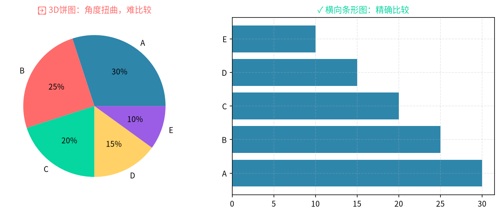

**正确做法**：把类别按数值排序，画横向条形图，一眼比出大小。哪怕只有 3 类，饼图也常常不如条形图直观——条形图比长度，比角度准得多。

### 反例二：Y 轴不从 0 开始

把 Y 轴从 95 起画到 100，两根只差 5% 的柱子看起来像差 5 倍——这是最常见的数据误导。柱状图的 Y 轴**必须从 0 开始**；只有折线图展示趋势时才允许截断，且要明确提示。

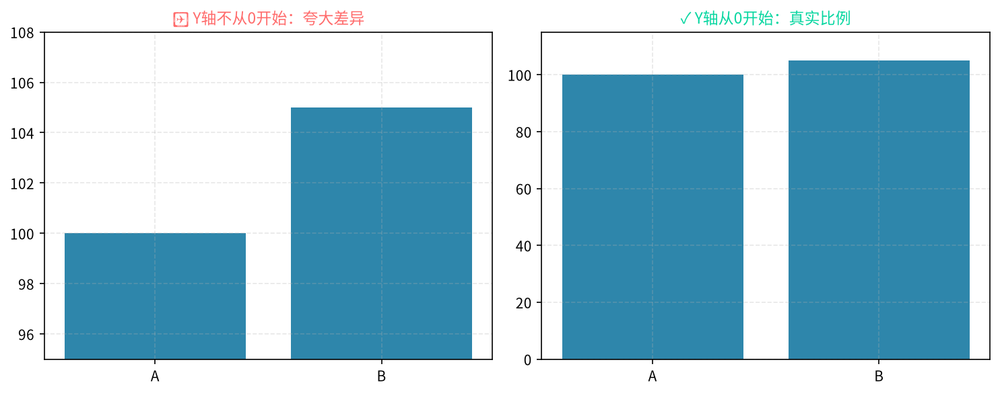

这种手法在营销材料和某些财经报告里非常常见：明明只是"比去年增长了 2%"，画出来像翻了一倍。作为数据从业者，看到这种图要能立刻识别，并提醒读者。

**要点**：柱状图 Y 轴从 0 起步；避免 3D 饼图；同一张图里颜色含义要一致；发出去之前对照反例自查一遍。

---

## 32.19 图表选择决策表

| 你想表达什么 | 推荐图表 | 关键函数 |
|---|---|---|
| 类别之间比大小 | 柱状图 / 横向条形图 | `ax.bar()` / `ax.barh()` |
| 随时间的趋势 | 折线图 | `ax.plot()` |
| 单变量分布 | 直方图 / 箱线图 | `ax.hist()` / `ax.boxplot()` |
| 两个连续变量的关系 | 散点图 | `ax.scatter()` |
| 矩阵 / 相关系数 | 热力图 | `sns.heatmap()` |
| 占比 | 饼图最多 3 类，否则改横向条形图 | `ax.pie()` |

记住一句话：**能用柱状图解决的，不要用饼图；能用折线图讲趋势的，不要用柱子堆时间。** 选图表的第一性原理是：你希望读者一眼看到什么？是长度差、斜率、分布形状还是相关矩阵？让数据的展示形式匹配你想让读者提取的信息，而不是反过来被图表类型绑架。

---

## 32.20 Gallery 一览

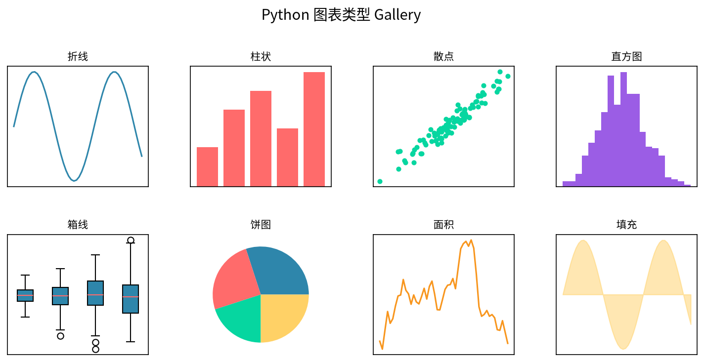

本章我们从 Matplotlib 的 Figure / Axes 三层结构讲起，覆盖了折线、柱状、堆叠、横向条形、散点、气泡、直方图、箱线图、热力图九种常用图表，介绍了子图布局和 Seaborn 的高级封装，最后给出了一套可复用的 `rcParams` 风格模板和两个典型反例。

实战建议：

1. 项目开头先 `import` 统一风格模板，不要每张图单独调；
2. 每画一张图，问自己"这张图要让读者一眼看出什么"，答不上来就重画；
3. 发出去之前，对照 32.18 的两条反例自查一遍：Y 轴从 0 起步了吗？有没有用 3D 饼图？
4. 配色尽量少而精，一张图里颜色不要超过 5 种；
5. 保存时用 `dpi=150–200`，兼顾清晰度和文件大小。

绘图是数据分析的最后一公里：你的分析再深刻，图讲不清楚，读者就接收不到。把这一章的模板存成自己的代码片段库，下次画图直接套，效率会高很多。

---

> **下一章：[回到目录](SUMMARY.md)**
