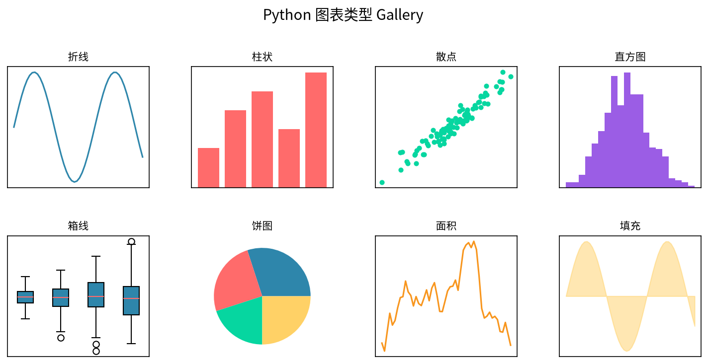

# 📊 数据分析实战手册

> 从 SQL 取数、Pandas 清洗、业务分析到机器学习建模——一本写给数据分析师的数据科学综合讲义。
>
> **31章 · 40万+字 · 配套可运行代码 · 对标世界一流教材**


[](LICENSE)
[](#-章节目录)
[](#️-配套代码)
[](#️-配套代码)
[](#)

---

## 📖 这本手册是什么

这是一份**系统性的数据科学学习与实战手册**，覆盖数据分析师 / 数据科学家从入门到进阶所需的完整知识体系：

- **基础层**：数据分析思维、SQL、Python(Pandas/NumPy)、统计推断、可视化
- **业务层**：业务分析方法论、A/B 测试与因果推断、用户行为、销售营收、运营分析
- **工程层**：数据报表自动化、数据仓库、ETL、调度、数据质量
- **机器学习层**：从特征工程到回归/分类/聚类/时序/NLP/推荐系统/异常检测的完整算法体系
- **落地层**：模型评估调优、MLOps 部署、6 个端到端项目案例
- **求职层**：80 道高频面试题与深度答案

### 适合谁读

| 读者 | 收益 |
|------|------|
| 在校生 / 转行者 | 建立完整知识体系，配套代码可跑通 |
| 1-3年数据分析师 | 补齐机器学习与工程化短板 |
| 业务分析师 | 掌握 SQL+Python+业务分析方法论 |
| 面试准备者 | 第31章 80 题直接演练 |

### 怎么读

- **初学者**：按章节顺序读（01 → 31），每章配合同目录下 `code/` 的代码跑一遍
- **有经验者**：按需查阅目录，直接跳到对应章节
- **面试者**：重点刷第31章 + 第16章项目案例

---

## 📚 章节目录

### 🌱 第一篇：基础入门（第01-03章）
- **第01章** 数据分析基础与思维框架
- **第02章** 数据获取与采集
- **第03章** 数据清洗与预处理

### 🔧 第二篇：工具技能（第04-08章）
- **第04章** 探索性数据分析（EDA）
- **第05章** 统计分析与假设检验
- **第06章** 数据可视化
- **第07章** SQL 数据分析实战
- **第08章** Python 数据分析（Pandas/NumPy）

### 💼 第三篇：业务分析（第09-14章）
- **第09章** 业务数据分析方法论
- **第10章** A/B 测试与因果推断
- **第11章** 用户行为分析
- **第12章** 销售与营收分析
- **第13章** 运营数据分析
- **第14章** 数据报表与自动化

### 🤖 第四篇：机器学习核心（第15-23、28章）
- **第15章** 机器学习在数据分析中的应用
- **第19章** 机器学习导论：问题类型与建模流程
- **第20章** 特征工程实战
- **第21章** 监督学习：回归算法
- **第22章** 监督学习：分类算法
- **第23章** 无监督学习：聚类与降维
- **第28章** 模型评估与调优

### 🎯 第五篇：专题算法（第24-27章）
- **第24章** 时间序列预测
- **第25章** 异常检测
- **第26章** NLP 在数据分析中的应用
- **第27章** 推荐系统基础

### 🏗️ 第六篇：工程与落地（第29-30章）
- **第29章** MLOps 与模型部署
- **第30章** 数据工程基础

### 🚀 第七篇：实战与求职（第16-18章、第31章）
- **第16章** 真实项目实战案例（6个完整项目）
- **第17章** 数据分析工具生态
- **第18章** 职业发展与面试指南
- **第31章** 数据分析高频面试80题与答案
- **第32章** Python绘图全教程（matplotlib + seaborn，20张配图）

---

## 🛠️ 配套代码

所有代码位于 [`code/`](code/) 目录，可直接运行：

```bash
# 安装依赖
pip install pandas numpy scikit-learn matplotlib seaborn statsmodels scipy

# 运行任意示例
python code/21-regression/housing_price_prediction.py
python code/22-classification/churn_prediction.py
python code/24-time-series/sales_forecast.py
python code/25-anomaly-detection/fraud_detection.py
python code/26-nlp/sentiment_analysis.py
python code/27-recommender/movie_recommender.py

# 6个端到端项目
python code/16-projects/project1-churn-prediction/main.py
python code/16-projects/project2-sales-forecast/main.py
python code/16-projects/project3-sentiment-analysis/main.py
python code/16-projects/project4-fraud-detection/main.py
python code/16-projects/project5-customer-segmentation/main.py
python code/16-projects/project6-ab-test-analysis/main.py
```

代码中使用的数据均为：
- scikit-learn 内置公开数据集
- `numpy.random` 生成的模拟数据
- 少量手写演示文本

**无需下载任何私有数据即可跑通。**

---

## 📊 配图预览

全书配有 **60 张图表**（PNG），全部由 `code/generate_all_charts.py` 自动生成：

```bash
# 一键重新生成所有配图
python code/generate_all_charts.py
```

图表类型涵盖：折线图、柱状图、散点图、直方图、箱线图、热力图、漏斗图、瀑布图、ROC 曲线、混淆矩阵、聚类图、时序分解、流程图、决策树图等。



---

## 📊 手册统计

| 指标 | 数值 |
|------|------|
| 章节数 | 32 章 |
| 总字数 | 25 万+ 中文字符 |
| 配套代码目录 | 9 个模块 |
| 端到端项目 | 6 个 |
| 面试题 | 80 道 |
| 配图 | 60 张 PNG（含第32章20张教程图） |
| 代码可运行 | ✅ |

---

## 🤝 贡献

欢迎 Issue 和 PR：

1. Fork 本仓库
2. 创建特性分支：`git checkout -b feature/your-chapter`
3. 提交修改：`git commit -m 'Add some chapter'`
4. 推送：`git push origin feature/your-chapter`
5. 提交 Pull Request

### 写作规范

- 每章 3000-8000 中文字符
- 概念讲解 + 可运行代码 + 实战案例 + 常见坑 + 小结
- 代码块标注语言（```python / ```sql）
- 章节结尾有"下一章"链接
- 全中文写作

---

## 📄 License

[MIT License](LICENSE)，自由使用、转载、修改，但请保留原作者署名。

---

> 如果这份手册对你有帮助，欢迎 ⭐ Star 支持！
>
> 仓库地址：[https://github.com/lizhengyang-byte/data-analysis-handbook](https://github.com/lizhengyang-byte/data-analysis-handbook)
